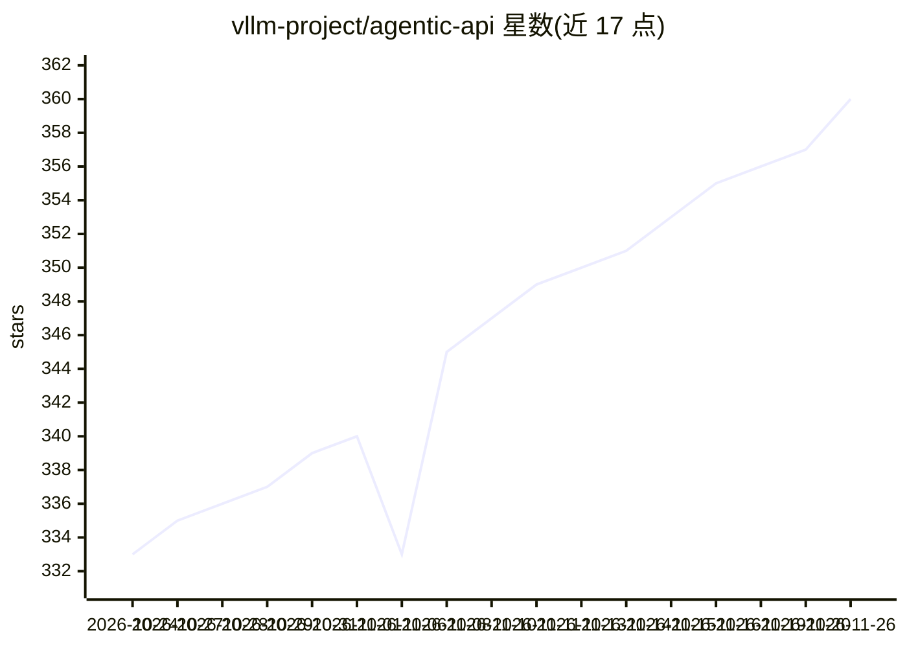

# vllm-project/agentic-api

⭐ 360 · Rust · Apache-2.0 · 推送 2026-11-24 · [GitHub](https://github.com/vllm-project/agentic-api) · [官网](https://vllm-project.github.io/agentic-api/) · 组织维护

**为 agentic 应用提供有状态 API 层的 vLLM Rust 网关**

用 Rust 编写的网关服务，部署在 vLLM 等推理后端之前，把对话状态、工具调用循环与多轮编排从客户端移到服务端。提供 OpenAI 兼容的 Responses API 与 Anthropic Messages API，服务端管理历史（previous_response_id / Conversations API）、执行网关侧工具（web search、fetch、MCP、file search、可选代码解释器）、支持多 agent 编排与上下文压缩，传输层覆盖 HTTP、SSE 与 WebSocket。默认存储为 SQLite，可换 PostgreSQL；通过 cargo 构建或 PyPI 包安装。

## 筛选速览

| 维度 | 判定 | 备注 |
|---|---|---|
| AI 角色 | `ai-ecosystem` | LLM/agent 周边工具 |
| 许可风险 | `permissive` | Apache-2.0 |
| 部署形态 | `library` | 以包/库形式分发 |
| 模型依赖 | local-ok | 支持本地模型 |
| 硬件要求 | — | 无带数字的原话,不猜 |
| 安装摩擦 | `low` | 无编译、无系统依赖或容器化 |
| 成熟度 | — | 结构信号不足 |

## 能力要点

- OpenAI 兼容 Responses API 与 Anthropic Messages API 的有状态服务端实现
- 工具所有权模型：网关执行 web search/MCP/file search，客户端工具原样返回
- 单请求服务端 spawn 子 agent 的多 agent 编排（HTTP/SSE/WebSocket）
- automatic 与 explicit 的上下文压缩端点 /v1/responses/compact

## 适用场景

- 在自己 GPU 上通过 vLLM 后端运行 Codex 会话
- 让 Claude Code CLI 接入自托管的开源模型
- 为需要多轮工具调用循环的应用做服务端状态管理
- 部署带 OpenTelemetry 观测的 agentic API 网关

## 场景标签

`Agent 框架` `多智能体` `模型网关` · 领域:Agent 开发

## 证据(README 行号)

> L16: **Agentic API moves it server-side.** It is a Rust-native gateway that sits in front of vLLM and owns the stateful 
> L14: vLLM gives you state-of-the-art inference throughput. But real agentic applications need more than raw tokens: they

## 星数曲线

2026-10-24 333 → 2026-11-26 360（+27）

---
*卡片 v1 · prompt 1.4 · 生成 2026-11-25 · 置信度 high · 依据 README sha `5b619b04bfca` · [字段定义](../../DATASET.md)*
