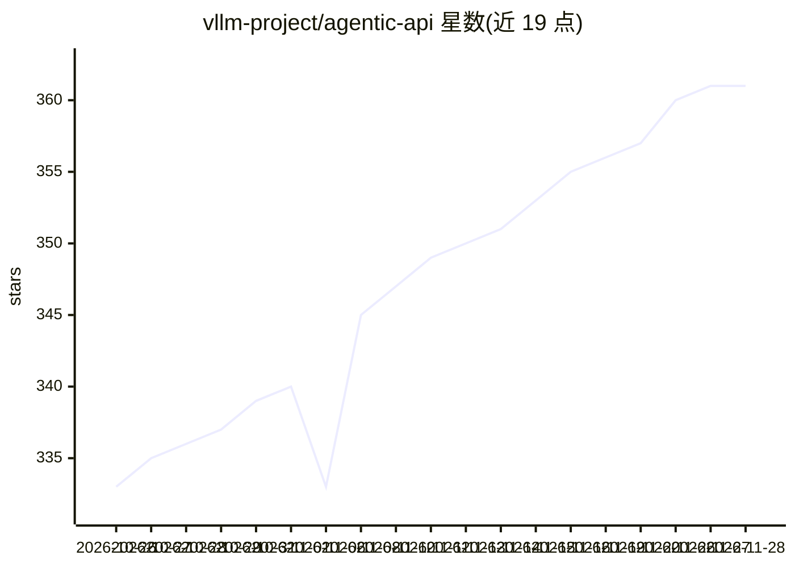

# vllm-project/agentic-api

⭐ 361 · Rust · Apache-2.0 · 推送 2026-11-27 · [GitHub](https://github.com/vllm-project/agentic-api) · [官网](https://vllm-project.github.io/agentic-api/) · 组织维护

**为 vLLM 提供有状态 Agentic API 的 Rust 网关**

以 Rust 编写的 API 网关，部署在 vLLM（或 SGLang、NVIDIA Dynamo）推理服务之前，将代理应用所需的会话状态、工具调用循环与多轮编排从客户端代码移到服务端：提供 OpenAI 兼容的 Responses API 与 Anthropic Messages API，服务端执行网络搜索、web fetch、MCP、file search 等网关自有工具，并通过 previous_response_id/Conversations API 恢复历史。支持 HTTP/SSE/WebSocket 三种传输，SQLite 为默认存储，可切换 PostgreSQL。通过 PyPI 包提供预编译二进制，或用 cargo 从源码构建。

## 筛选速览

| 维度 | 判定 | 备注 |
|---|---|---|
| AI 角色 | `ai-ecosystem` | LLM/agent 周边工具 |
| 许可风险 | `permissive` | Apache-2.0 |
| 部署形态 | `library` | 以包/库形式分发 |
| 模型依赖 | local-ok | 支持本地模型 |
| 硬件要求 | — | 无带数字的原话,不猜 |
| 安装摩擦 | `low` | 无编译、无系统依赖或容器化 |
| 成熟度 | — | 结构信号不足 |

## 能力要点

- OpenAI 兼容 Responses API 与 Anthropic Messages API（/v1/messages）
- 服务端工具执行：web search（You.com/Brave/Tavily/SearXNG 等）、MCP、file search、可选内嵌代码解释器
- 多代理编排：一个请求可服务端派生并协调子代理
- 通过 agentic CLI 一条命令接入 OpenAI Codex 或 Claude Code

## 适用场景

- 让 OpenAI Codex/Claude Code 直接跑在自己 GPU 上的开源模型
- 为代理应用托管会话状态与工具调用循环
- 服务端协调多代理任务并返回归因的子代理输出
- 为自建推理上游补充文件检索与向量存储 API

## 场景标签

`模型网关` · 领域:Agent 开发

## 证据(README 行号)

> L16: **Agentic API moves it server-side.** It is a Rust-native gateway that sits in front of vLLM and owns the stateful 
> L31: - 🛠️ **Server-side tools**: an explicit ownership model decides what runs where. Web search (You.com, Brave, Tavily
> L34: - 🧰 **Codex and Claude Code ready**: Codex-shaped Responses traffic and Anthropic Messages traffic keep the tool de

## 星数曲线

2026-10-26 333 → 2026-11-28 361（+28）

---
*卡片 v1 · prompt 1.4 · 生成 2026-11-28 · 置信度 high · 依据 README sha `fa2cb2f817dd` · [字段定义](../../DATASET.md)*
