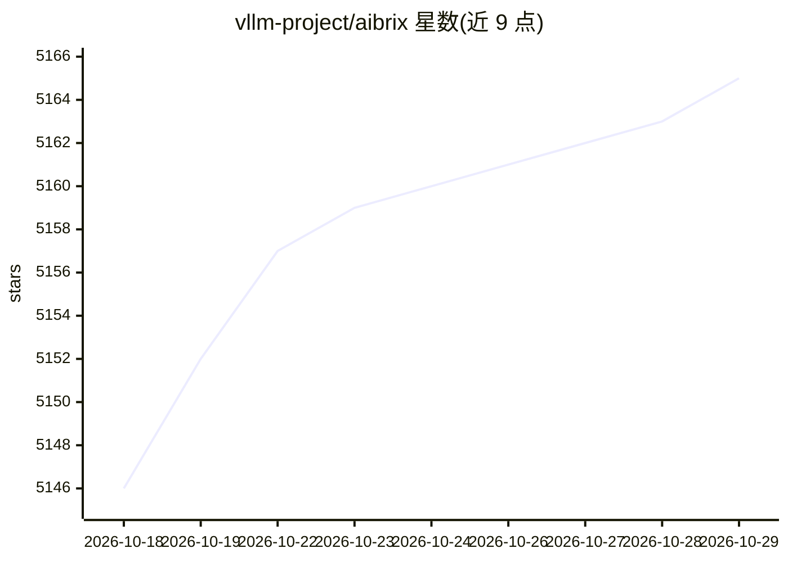

# vllm-project/aibrix

⭐ 5,165 · Go · Apache-2.0 · 推送 2026-10-28 · [GitHub](https://github.com/vllm-project/aibrix) · 组织维护

**面向生产 LLM 推理的 Kubernetes 控制平面与网关**

AIBrix 是部署在 Kubernetes 上的 GenAI 推理基础设施层：用户自带推理引擎（vLLM、SGLang、TensorRT-LLM），AIBrix 通过 OpenAI 兼容网关按引擎实时状态路由请求，并基于队列深度、KV cache、token 等指标做副本自动扩缩。控制面管理模型生命周期（ModelClaim/ModelWarmup）、LoRA 适配器打包、多节点多角色部署（prefill/decode）、分布式 KV cache 卸载与异构 GPU 混部（实验性）。安装为 kubectl apply 发布清单或源码部署，依赖 Envoy Gateway 与 KubeRay。

## 筛选速览

| 维度 | 判定 | 备注 |
|---|---|---|
| AI 角色 | `ai-ecosystem` | LLM/agent 周边工具 |
| 许可风险 | `permissive` | Apache-2.0 |
| 部署形态 | `library` | 以包/库形式分发 |
| 模型依赖 | local-ok | 支持本地模型 |
| 硬件要求 | — | 无带数字的原话,不猜 |
| 安装摩擦 | `low` | 无编译、无系统依赖或容器化 |
| 成熟度 | `idea` | |

## 能力要点

- OpenAI 兼容网关，按 prefix-cache/负载/prefill-decode 位置选 pod 路由
- 多引擎统一服务：vLLM、SGLang、TensorRT-LLM
- ModelClaim 声明模型与 ModelWarmup 预热以加速扩容
- 多节点分布式推理与跨引擎 KV cache 复用

## 适用场景

- 在 Kubernetes 上运维多模型/多副本的 LLM 推理服务
- 混合 GPU 机型集群中控制推理成本与延迟目标
- 为 agentic 工作负载提供会话亲和的请求路由

## 场景标签

`推理引擎` `模型网关` · 领域:Agent 开发

## 证据(README 行号)

> L14: AIBrix is a Kubernetes control plane for production LLM inference. You bring the engine — vLLM, SGLang, or TensorRT
> L36: Requests hit an OpenAI-compatible gateway and go straight to an engine pod. Kubernetes controllers decide what shou

## 星数曲线

2026-10-18 5,146 → 2026-10-29 5,165（+19）

---
*卡片 v1 · prompt 1.4 · 生成 2026-10-20 · 置信度 high · 依据 README sha `bbcebd15b7dd` · [字段定义](../../DATASET.md)*
