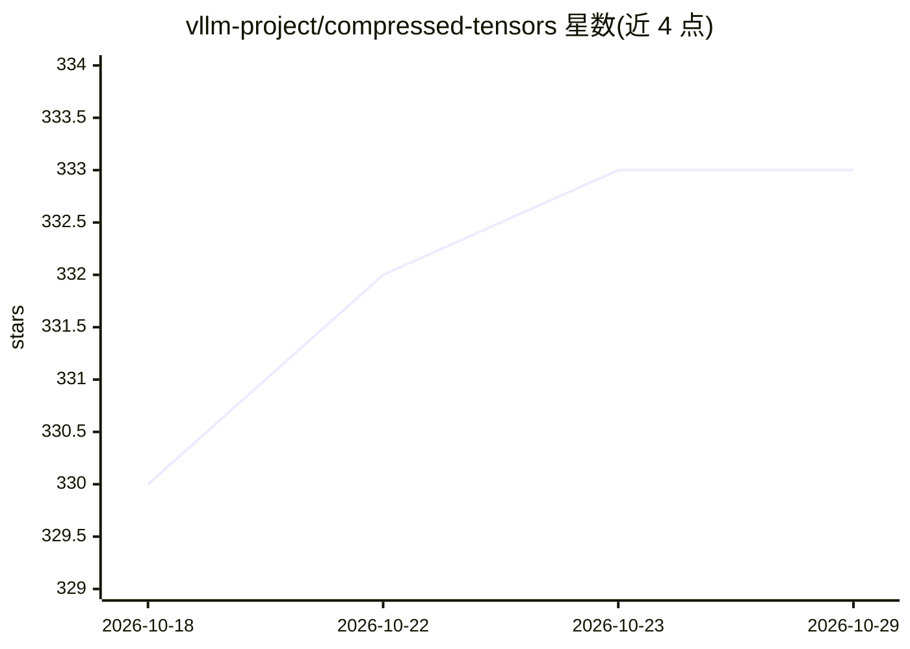

# vllm-project/compressed-tensors

⭐ 333 · Python · Apache-2.0 · 推送 2026-10-28 · [GitHub](https://github.com/vllm-project/compressed-tensors) · [官网](https://docs.vllm.ai/projects/compressed-tensors) · 组织维护

**safetensors 扩展库：统一存储稀疏量化张量的磁盘格式**

扩展 safetensors 格式的 Python 库，为多种压缩方案（GPTQ、AWQ、SmoothQuant、SparseGPT 等，覆盖 INT8/FP8/NVFP4/MXFP4/MXFP8）提供统一的检查点格式，支持激活量化、混合精度、KV cache 量化、非均匀方案、2:4 稀疏与旋转变换。可将 AutoAWQ、ModelOpt 等格式互转，支持超出显存的 CPU/磁盘/分布式卸载，设计为与 Hugging Face、PyTorch、vLLM、SGLang 配合使用。面向做模型压缩与部署的开发者和研究者。限制：本身不执行推理，是存储与转换层。

## 筛选速览

| 维度 | 判定 | 备注 |
|---|---|---|
| AI 角色 | `ai-ecosystem` | LLM/agent 周边工具 |
| 许可风险 | `permissive` | Apache-2.0 |
| 部署形态 | `library` | 以包/库形式分发 |
| 模型依赖 | local-ok | 支持本地模型 |
| 硬件要求 | — | 无带数字的原话,不猜 |
| 安装摩擦 | `low` | 无编译、无系统依赖或容器化 |
| 成熟度 | — | 结构信号不足 |

## 能力要点

- 单一格式支持多种量化/稀疏/压缩方案
- AutoAWQ、ModelOpt NVFP4、FP8 block 等格式间检查点转换
- 模型超出 VRAM 时的透明 CPU/磁盘/分布式卸载
- 无需校准数据的 RTN MXFP4 量化示例

## 适用场景

- 把不同量化算法产出的模型统一到一种检查点格式
- 压缩 Llama 类大模型为 MXFP4 等低精度格式
- 推理引擎间切换时减少多格式适配成本

## 场景标签

`模型量化` · 领域:训练与推理

## 证据(README 行号)

> L3: The `compressed-tensors` library extends the safetensors format, providing a versatile and efficient way to store an
> L23: * **Open-Source Integration**: Designed to work seamlessly with Hugging Face models, PyTorch, vLLM, and SGLang.
> L25: This allows developers and researchers to easily experiment with composing different quantization methods, simplify

## 星数曲线

2026-10-18 330 → 2026-10-29 333（+3）

---
*卡片 v1 · prompt 1.4 · 生成 2026-10-21 · 置信度 high · 依据 README sha `da636cd3cb9b` · [字段定义](../../DATASET.md)*
