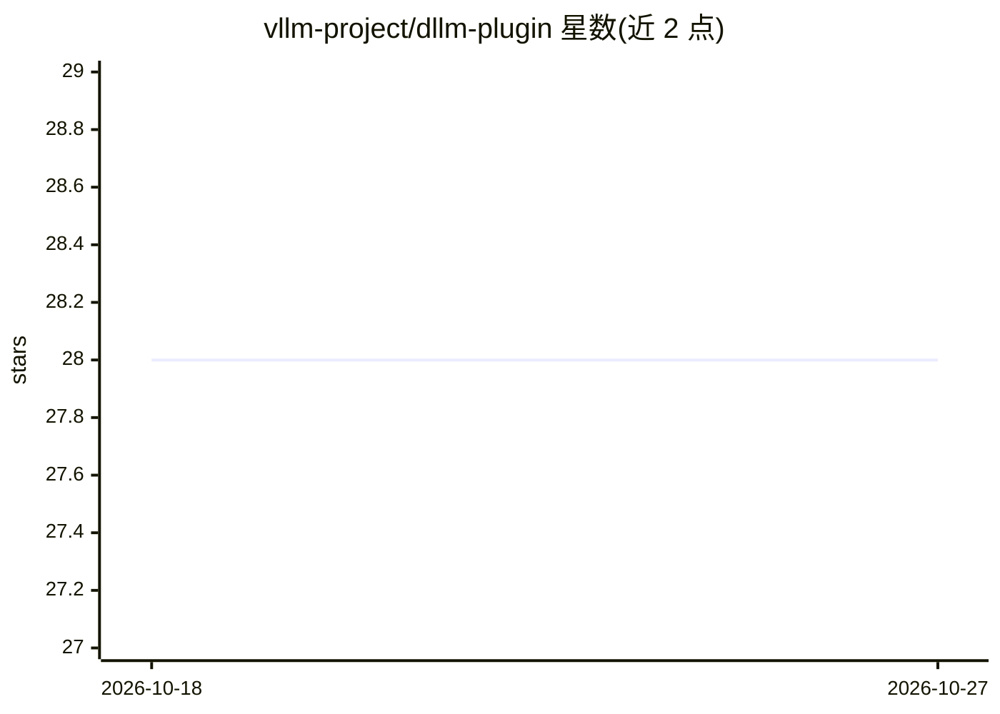

# vllm-project/dllm-plugin

⭐ 28 · Python · Apache-2.0 · 推送 2026-05-25 · [GitHub](https://github.com/vllm-project/dllm-plugin) · 组织维护

**vLLM 插件：为块扩散语言模型（dLLM）提供运行支持**

面向 vLLM 的插件包，通过 `vllm.general_plugins` 入口点为块扩散语言模型（dLLM）注册架构，提供运行时调度器/工作器适配器（DllmRuntimeScheduler/DllmRuntimeWorker）、重掩码契约、严格栈校验与 CPU CI 冒烟测试。限制：当前注册的为 mock 模型，LLaDA2.0 生产模型逻辑仍在开发中；生产使用需 vLLM 的 dllm-fork-coherent 分支（基础 v0.20.2 会产生错误注意力）；PP>1 不支持。需 Python 3.10–3.13 与 uv 开发环境，vLLM 为可选 extra（>=0.20,<0.21）。

## 筛选速览

| 维度 | 判定 | 备注 |
|---|---|---|
| AI 角色 | `ai-ecosystem` | LLM/agent 周边工具 |
| 许可风险 | `permissive` | Apache-2.0 |
| 部署形态 | `library` | 以包/库形式分发 |
| 模型依赖 | local-ok | 支持本地模型 |
| 硬件要求 | — | 无带数字的原话,不猜 |
| 安装摩擦 | `medium` | 含编译或系统依赖之一 |
| 成熟度 | `idea` | |

## 能力要点

- vLLM general_plugins 入口点注册 dLLM 架构与调度器/工作器适配器
- TP=1/2/4/8 已验证，CUDAGraph 经 UNIFORM_BATCH 模式支持，PP>1 不支持
- 严格栈校验 assert_compatible_stack 提前拒绝不兼容组合
- 提供 CPU CI 冒烟与 GPU 门控端到端 mock-stack LLM.generate 测试

## 适用场景

- 在 vLLM 中运行 LLaDA2.0 等块扩散语言模型
- 开发者参与 dLLM 支持的开发与测试（含无 CUDA 的 macOS 环境）
- 通过 --scheduler-cls/--worker-cls 挂载 dLLM 运行时适配器

## 场景标签

`推理引擎` · 领域:训练与推理

## 证据(README 行号)

> L5: **vllm-dllm-plugin** is a vLLM plugin for **block-based diffusion language models (dLLMs)**. The package provides a 
> L7: **Important:** `register_dllm()` first checks `importlib.util.find_spec("vllm")`; if `vllm` is not discoverable on `
> L70: vllm serve <model> \

## 星数曲线

2026-10-18 28 → 2026-10-27 28（+0）

---
*卡片 v1 · prompt 1.4 · 生成 2026-10-26 · 置信度 high · 依据 README sha `18fed091bb04` · [字段定义](../../DATASET.md)*
