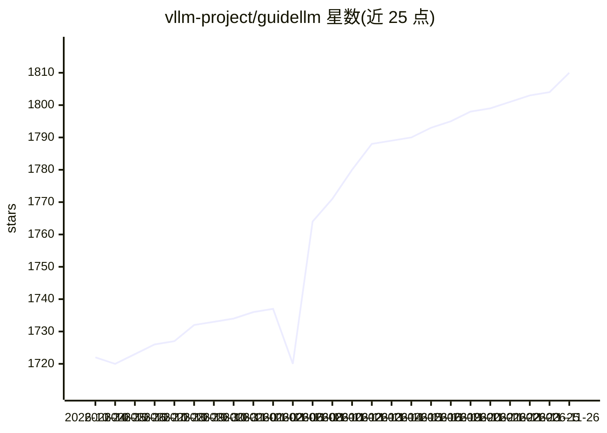

# vllm-project/guidellm

⭐ 1,810 · Python · Apache-2.0 · 推送 2026-11-25 · [GitHub](https://github.com/vllm-project/guidellm) · [官网](https://vllm-project.github.io/guidellm/) · 组织维护 · 中文 README

**面向工程团队的 LLM 推理服务基准评测平台**

GuideLLM 是一个评测 LLM 推理服务在真实负载下表现的基准平台：向 OpenAI 兼容或 vLLM 原生服务端发起模拟请求，生成同步、并发、速率型等多种流量模式，采集 TTFT/ITL 与端到端延迟的完整分布，并按 SLO 输出 JSON/CSV/HTML 等格式报告。支持真实数据集、HuggingFace 数据集与合成文本/图像/视频数据，带预热、冷却、过饱和检测等测量控制，以 pip 包与多架构容器镜像分发，要求 Python 3.11-3.15、Linux 或 macOS。

## 筛选速览

| 维度 | 判定 | 备注 |
|---|---|---|
| AI 角色 | `ai-ecosystem` | LLM/agent 周边工具 |
| 许可风险 | `permissive` | Apache-2.0 |
| 部署形态 | `desktop` | 安装包/桌面程序 |
| 模型依赖 | local-ok | 支持本地模型 |
| 硬件要求 | — | 无带数字的原话,不猜 |
| 安装摩擦 | `low` | 无编译、无系统依赖或容器化 |
| 成熟度 | — | 结构信号不足 |

## 能力要点

- SLO 导向的 TTFT/ITL/端到端延迟完整分布统计
- sweep 模式扫描最大性能与安全运行区间
- 支持 synthetic_image/synthetic_video 合成多模态基准数据
- 多架构容器镜像（linux/amd64 与 linux/arm64），适配 Docker/Podman/Kubernetes/OpenShift

## 适用场景

- 部署 LLM 服务前评估容量与资源需求
- 用恒定/泊松速率负载做压测定位性能拐点
- 跨版本回归跟踪推理服务性能变化
- 无需自备数据集即可测试 VLM 服务配置

## 场景标签

`模型评测` · 领域:评测与运维

## 证据(README 行号)

> L13: **GuideLLM** is a platform for evaluating how language models perform under real workloads and configurations. It s
> L23: - **Delivers high-throughput, extensible benchmarking** with multiprocessing, threading, async execution, and a fle

## 星数曲线

2026-10-24 1,722 → 2026-11-26 1,810（+88）

---
*卡片 v1 · prompt 1.4 · 生成 2026-11-23 · 置信度 high · 依据 README sha `88d9b1ed46ca` · [字段定义](../../DATASET.md)*
