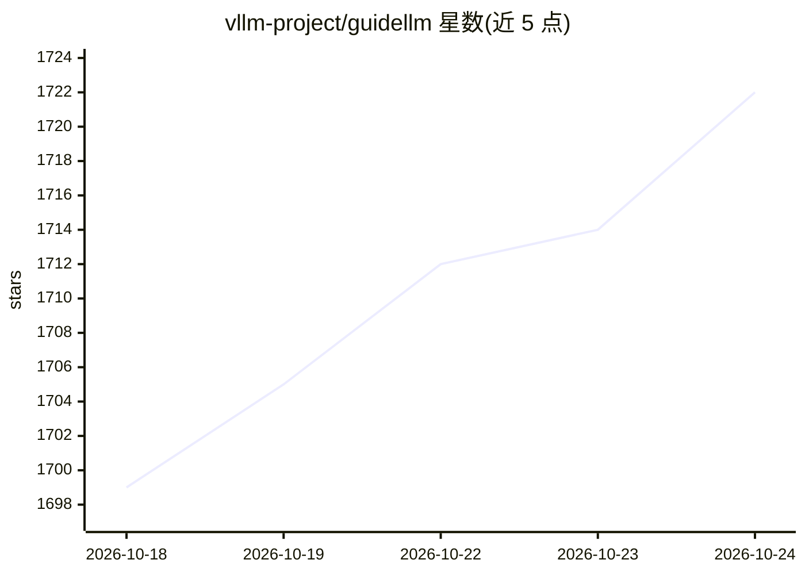

# vllm-project/guidellm

⭐ 1,722 · Python · Apache-2.0 · 推送 2026-10-23 · [GitHub](https://github.com/vllm-project/guidellm) · [官网](https://vllm-project.github.io/guidellm/) · 组织维护

**面向 SLO 的 LLM 推理服务基准测试与评估平台**

vLLM 项目下的 LLM 推理基准评测平台：模拟与 OpenAI 兼容及 vLLM 原生服务器的端到端交互，生成同步/并发/恒定速率/泊松/sweep 等流量模式，采集 TTFT、ITL、端到端延迟等 token 级统计，输出 JSON/CSV/HTML/PLOT 报告。支持 HuggingFace 数据集、本地文件与合成文本/图像/视频数据，可测聊天补全、补全、嵌入、音频转录等 API。面向工程与 ML 团队做部署调优与容量规划。以 pip 安装、源码安装及多架构容器镜像提供。

## 筛选速览

| 维度 | 判定 | 备注 |
|---|---|---|
| AI 角色 | `ai-ecosystem` | LLM/agent 周边工具 |
| 许可风险 | `permissive` | Apache-2.0 |
| 部署形态 | `desktop` | 安装包/桌面程序 |
| 模型依赖 | local-ok | 支持本地模型 |
| 硬件要求 | — | 无带数字的原话,不猜 |
| 安装摩擦 | `low` | 无编译、无系统依赖或容器化 |
| 成熟度 | — | 结构信号不足 |

## 能力要点

- TTFT/ITL/端到端全分布延迟统计的 SLO 驱动评估
- synchronous/concurrent/constant/poisson/sweep 等可复现流量模式
- 支持 HuggingFace 数据集、本地文件及合成文本/图像/视频多模态数据
- 输出 JSON/CSV/HTML/PLOT 标准化报告，提供 CLI 与 API

## 适用场景

- 对部署的 LLM 服务做压测，找出安全运行的速率区间
- 比较不同推理配置下的延迟与吞吐表现
- 为生产环境容量规划提供 SLO 依据
- 对 VLM 视觉语言服务做合成图像/视频基准测试

## 场景标签

 · 领域:LLM 基础设施/性能评测

## 证据(README 行号)

> L3: SLO-aware Benchmarking and Evaluation Platform for Optimizing Real-World LLM Inference
> L11: **GuideLLM** is a platform for evaluating how language models perform under real workloads and configurations. It s
> L17: - **Captures complete latency and token-level statistics for SLO-driven evaluation**, including full distributions 

## 星数曲线

2026-10-18 1,699 → 2026-10-24 1,722（+23）

---
*卡片 v1 · prompt 1.4 · 生成 2026-10-21 · 置信度 high · 依据 README sha `2dc5efed3073` · [字段定义](../../DATASET.md)*
