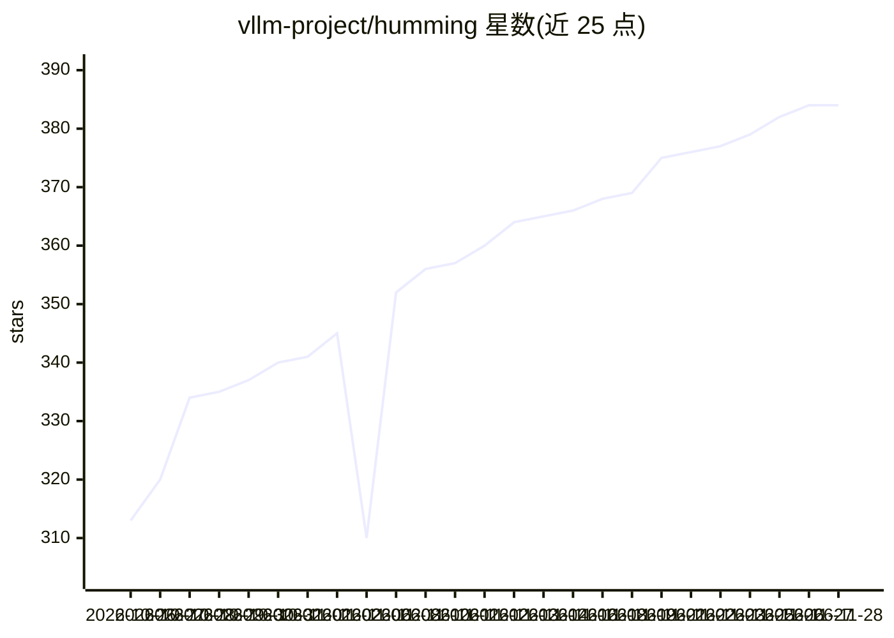

# vllm-project/humming

⭐ 384 · Python · Apache-2.0 · 推送 2026-11-25 · [GitHub](https://github.com/vllm-project/humming) · 组织维护 · 中文 README

**面向量化推理的 JIT 编译 GEMM 核库，作为 vLLM 的量化后端**

由蚂蚁集团与 vLLM 社区开发的 JIT 编译 GEMM 核库，作为 vLLM 中的量化 GEMM 后端发布。支持 8-bit 以下任意权重类型在 FP16/BF16/FP8/FP4/INT8/INT4 激活下的推理，覆盖 WNA16、W8A8、MXFP4、NVFP4 等量化策略，包含 Dense 与 MoE GEMM（Indexed/Grouped）。硬件覆盖 SM75 起的全部 NVIDIA 架构及 CUDA 兼容设备。仅依赖 PyTorch 与 CUDA 编译器，wheel 约 500 KB，核按需编译并缓存。以 pip 包提供。

## 筛选速览

| 维度 | 判定 | 备注 |
|---|---|---|
| AI 角色 | `ai-ecosystem` | LLM/agent 周边工具 |
| 许可风险 | `permissive` | Apache-2.0 |
| 部署形态 | `library` | 以包/库形式分发 |
| 模型依赖 | local-ok | 支持本地模型 |
| 硬件要求 | — | 无带数字的原话,不猜 |
| 安装摩擦 | `medium` | 含编译或系统依赖之一 |
| 成熟度 | — | 结构信号不足 |

## 能力要点

- 支持任意 8-bit 以下权重类型与 FP16/FP8/FP4/INT8/INT4 激活组合
- 支持 Dense GEMM 与 MoE GEMM（Indexed 与 Grouped 布局）
- 硬件覆盖 SM75（Turing）起的 NVIDIA 架构及 CUDA 兼容设备（如平头哥镇武 810E）
- 仅依赖 PyTorch 与 CUDA 编译器，wheel 约 500 KB，核按需编译缓存

## 适用场景

- 在 vLLM 中部署量化模型并替换量化 GEMM 后端
- 在 Hopper/Blackwell 等 GPU 上运行 W4A8/MXFP4 等量化矩阵乘
- 为 CUDA 兼容国产设备接入量化推理核

## 场景标签

`推理引擎` `模型量化` · 领域:训练与推理

## 证据(README 行号)

> L3: Humming is a high-performance, lightweight, and highly flexible JIT (Just-In-Time) compiled GEMM kernel library spec
> L17:  * Minimal dependencies: Requires only **PyTorch** and a CUDA compiler (NVCC or NVRTC).

## 星数曲线

2026-10-26 313 → 2026-11-28 384（+71）

---
*卡片 v1 · prompt 1.4 · 生成 2026-11-25 · 置信度 high · 依据 README sha `6c8c2f760bc1` · [字段定义](../../DATASET.md)*
