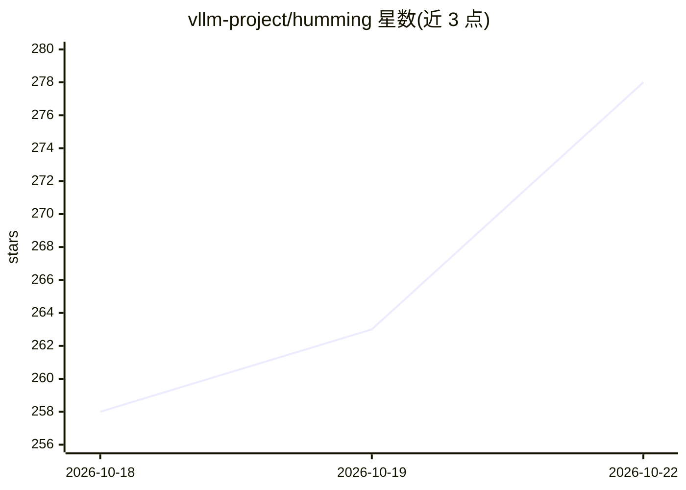

# vllm-project/humming

⭐ 278 · Python · Apache-2.0 · 推送 2026-10-21 · [GitHub](https://github.com/vllm-project/humming) · 组织维护

**面向量化推理的 JIT 编译 GEMM 核库，供 NVIDIA GPU 使用**

vllm-project 下的轻量级 GEMM 核函数库：以 JIT 方式为量化推理生成矩阵乘核，支持 8 位以下任意权重类型搭配 FP16/BF16/FP8/FP4/INT8/INT4 激活，覆盖 Dense GEMM 与 MoE GEMM，支持多种量化策略与 scale 类型（BF16/FP16/E4M3/E5M2/UE8M0）。兼容 SM75 及以上的 NVIDIA GPU。依赖仅 PyTorch 与 NVCC，包体积 100+KB，以 pip 包形式安装，供推理框架或内核开发者集成。

## 筛选速览

| 维度 | 判定 | 备注 |
|---|---|---|
| AI 角色 | `ai-ecosystem` | LLM/agent 周边工具 |
| 许可风险 | `permissive` | Apache-2.0 |
| 部署形态 | `library` | 以包/库形式分发 |
| 模型依赖 | — | README 未给出锁定关系 |
| 硬件要求 | — | 无带数字的原话,不猜 |
| 安装摩擦 | `medium` | 含编译或系统依赖之一 |
| 成熟度 | — | 结构信号不足 |

## 能力要点

- JIT 编译生成量化 GEMM 核，支持 8 位以下任意权重类型与 6 种激活类型
- 同时支持 Dense GEMM 与 MoE GEMM
- 兼容 SM75+ 的 NVIDIA GPU（Turing 及以后）
- 依赖仅 PyTorch 与 NVCC，包体积 100+KB

## 适用场景

- 为量化模型推理提供低比特 GEMM 核
- 在 MoE 模型推理中执行专家层矩阵乘
- 研究不同激活/权重类型组合下的量化核支持范围

## 场景标签

 · 领域:深度学习推理基础设施/算子库

## 证据(README 行号)

> L3: Humming is a high-performance, lightweight, and highly flexible JIT (Just-In-Time) compiled GEMM kernel library spec
> L16:  * Minimal dependencies: Requires only **PyTorch** and **NVCC**.

## 星数曲线

2026-10-18 258 → 2026-10-22 278（+20）

---
*卡片 v1 · prompt 1.4 · 生成 2026-10-22 · 置信度 high · 依据 README sha `3b0ba553552e` · [字段定义](../../DATASET.md)*
