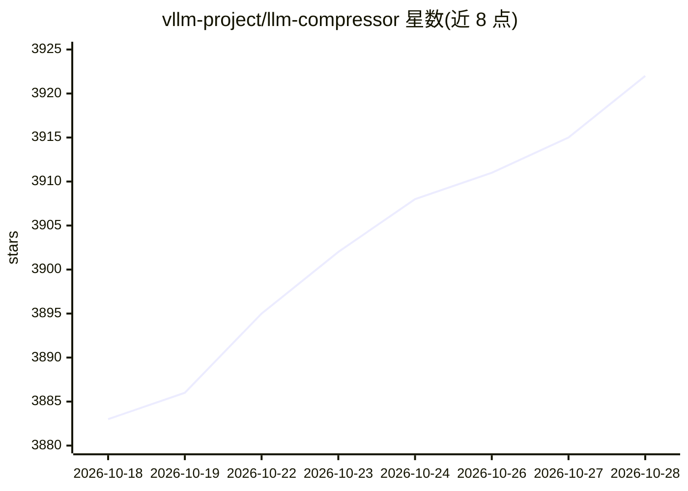

# vllm-project/llm-compressor

⭐ 3,926 · Python · Apache-2.0 · 推送 2026-10-28 · [GitHub](https://github.com/vllm-project/llm-compressor) · [官网](https://docs.vllm.ai/projects/llm-compressor) · 组织维护 · 中文 README

**面向 vLLM 生产推理的 LLM 量化压缩库**

由 Red Hat AI 与 vLLM 项目维护的模型压缩 Python 库：提供 PTQ、GPTQ、AWQ、SmoothQuant、AutoRound、SpinQuant/QuIP、REAP 专家剪枝等算法，覆盖权重、激活、KV cache 与注意力的 INT4/FP8/NVFP4/MXFP4 等精度方案。量化产物以 compressed-tensors 格式保存，可直接由 vLLM 加载推理；支持 DDP、顺序加载与磁盘卸载以压缩超大模型，并与 Hugging Face 模型生态集成。pip 安装，附大量端到端示例与分步指南。

## 筛选速览

| 维度 | 判定 | 备注 |
|---|---|---|
| AI 角色 | `ai-ecosystem` | LLM/agent 周边工具 |
| 许可风险 | `permissive` | Apache-2.0 |
| 部署形态 | `library` | 以包/库形式分发 |
| 模型依赖 | local-ok | 支持本地模型 |
| 硬件要求 | — | 无带数字的原话,不猜 |
| 安装摩擦 | `low` | 无编译、无系统依赖或容器化 |
| 成熟度 | — | 结构信号不足 |

## 能力要点

- GPTQ/AWQ/SmoothQuant/SpinQuant 等多种量化算法与 INT4/FP8/NVFP4/MXFP4 精度方案
- 量化产物为 compressed-tensors 格式，可直接由 vLLM 加载运行
- DDP、顺序加载与磁盘卸载支持压缩超大模型
- Red Hat AI 团队基于其发布多款量产级量化 checkpoint

## 适用场景

- 把 Hugging Face 模型量化成 FP8/FP4 checkpoint 以降低部署显存占用
- 为 vLLM 推理服务准备压缩后的模型权重
- 对 MoE 或超大模型做分布式或卸载式量化

## 场景标签

`模型量化` · 领域:训练与推理

## 证据(README 行号)

> L19: `llmcompressor` is the fast, efficient, and easy-to-use library for optimizing models for deployment with vLLM, inc
> L23: * Models saved in the `compressed-tensors` format, compatible with vLLM
> L180: ### Inference with vLLM

## 星数曲线

2026-10-18 3,883 → 2026-10-28 3,922（+39）

---
*卡片 v1 · prompt 1.4 · 生成 2026-10-20 · 置信度 high · 依据 README sha `d84833d92ee0` · [字段定义](../../DATASET.md)*
