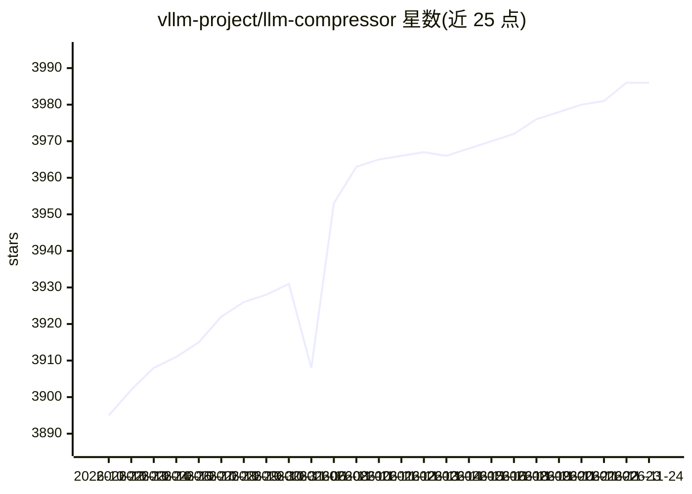

# vllm-project/llm-compressor

⭐ 3,987 · Python · Apache-2.0 · 推送 2026-11-23 · [GitHub](https://github.com/vllm-project/llm-compressor) · [官网](https://docs.vllm.ai/projects/llm-compressor) · 组织维护 · 中文 README

**为 vLLM 部署压缩 LLM 的量化库**

llmcompressor 是一个面向 vLLM 部署的模型优化库：提供权重、激活、KV cache 与 attention 的量化算法与变换，覆盖 GPTQ、AWQ、SmoothQuant、AutoRound、SpinQuant/QuIP 旋转与 REAP 专家剪枝等算法，输出 compressed-tensors 格式检查点供 vLLM 加载。与 Hugging Face 模型和仓库集成，支持 DDP 与磁盘 offloading 以压缩超大模型，提供 oneshot、model_free_ptq 等 API，通过 pip 安装，由 Red Hat AI 与 vLLM Project 维护。

## 筛选速览

| 维度 | 判定 | 备注 |
|---|---|---|
| AI 角色 | `ai-ecosystem` | LLM/agent 周边工具 |
| 许可风险 | `permissive` | Apache-2.0 |
| 部署形态 | `library` | 以包/库形式分发 |
| 模型依赖 | local-ok | 支持本地模型 |
| 硬件要求 | — | 无带数字的原话,不猜 |
| 安装摩擦 | `low` | 无编译、无系统依赖或容器化 |
| 成熟度 | — | 结构信号不足 |

## 能力要点

- 支持 W8A8、NVFP4/MXFP4、W4A16 等多种量化精度与低比特量化
- 支持 GPTQ、AWQ、SmoothQuant、AutoRound、REAP 等量化算法
- DDP 与磁盘 offloading 支持超大模型压缩
- 输出 compressed-tensors 格式，可在 vLLM 中加载运行

## 适用场景

- 为 vLLM 生产推理准备量化后的模型检查点
- 将超大模型按层顺序压缩以降低显存需求
- 对 MoE、视觉语言、音频语言模型做架构特定的量化

## 场景标签

`模型量化` · 领域:训练与推理

## 证据(README 行号)

> L19: `llmcompressor` is the fast, efficient, and easy-to-use library for optimizing models for deployment with vLLM, inc
> L23: * Models saved in the `compressed-tensors` format, compatible with vLLM
> L104: ### Supported Algorithms

## 星数曲线

2026-10-22 3,895 → 2026-11-24 3,986（+91）

---
*卡片 v1 · prompt 1.4 · 生成 2026-11-23 · 置信度 high · 依据 README sha `a5d4a2960cab` · [字段定义](../../DATASET.md)*
