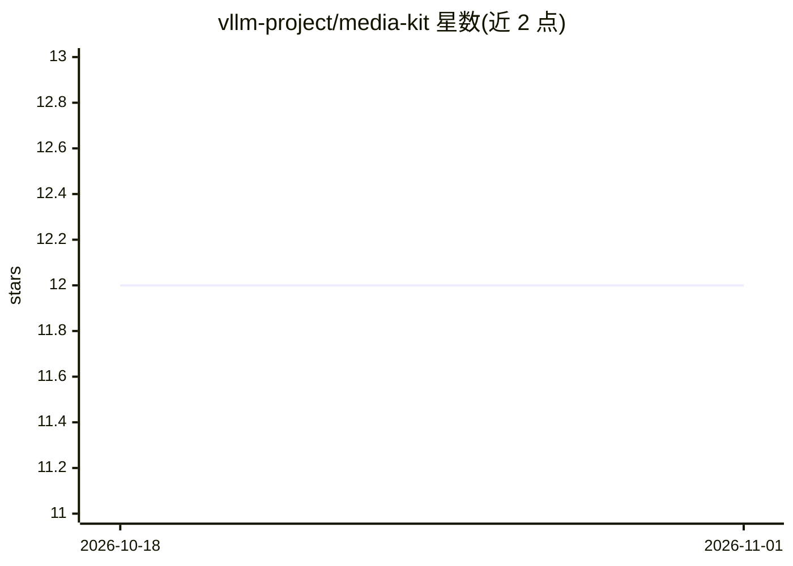

# vllm-project/media-kit

⭐ 12 · 推送 2026-01-15 · [GitHub](https://github.com/vllm-project/media-kit) · 组织维护

**vLLM 官方 Logo 素材库：多格式多版本品牌资产**

vLLM 项目官方品牌素材仓库，提供完整版与紧凑版 Logo 的 SVG（矢量）和 PNG（高分辨率）文件，并区分浅色与深色模式版本。README 给出文件格式选择建议（Web 场景优先 SVG、需要位图时用 PNG）、各版本使用场景、留白与比例等使用规范，以及品牌色值（黄 #fdb515、蓝 #30a2ff）。面向需要在演示、网站或文档中使用 vLLM 品牌标识的用户，如需额外格式可在仓库开 issue。

## 筛选速览

| 维度 | 判定 | 备注 |
|---|---|---|
| AI 角色 | `ai-ecosystem` | LLM/agent 周边工具 |
| 许可风险 | `none` | — |
| 部署形态 | `None` |  |
| 模型依赖 | local-ok | 支持本地模型 |
| 硬件要求 | — | 无带数字的原话,不猜 |
| 安装摩擦 | `low` | 无编译、无系统依赖或容器化 |
| 成熟度 | — | 结构信号不足 |

## 能力要点

- 提供 SVG 与 PNG 两种格式的官方 Logo
- 完整版/紧凑版及深浅色模式多个变体
- 给出品牌色值与使用规范（留白、比例、格式选择）

## 适用场景

- 在网站或演示文稿中使用 vLLM 官方 Logo
- 为深色背景界面选用深色版 Logo
- 按品牌色值 #fdb515 / #30a2ff 制作 vLLM 相关视觉物料

## 场景标签

 · 领域:品牌/设计资产

## 证据(README 行号)

> L1: # vLLM Media Kit
> L3: This repository contains official logo assets for vLLM in various formats and styles.

## 星数曲线

2026-10-18 12 → 2026-11-01 12（+0）

---
*卡片 v1 · prompt 1.4 · 生成 2026-10-31 · 置信度 high · 依据 README sha `aad802ca2233` · [字段定义](../../DATASET.md)*
