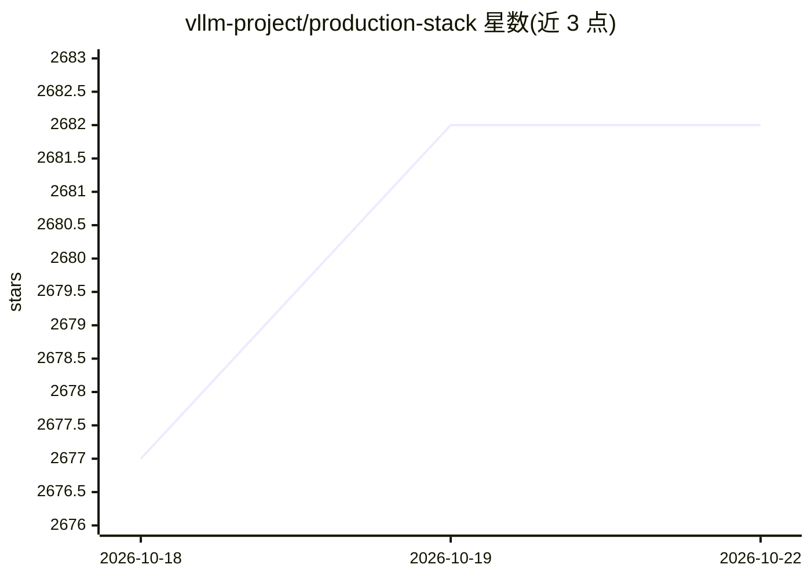

# vllm-project/production-stack

⭐ 2,682 · Python · Apache-2.0 · 推送 2026-10-14 · [GitHub](https://github.com/vllm-project/production-stack) · [官网](https://docs.vllm.ai/projects/production-stack) · 组织维护

**面向开发者的 vLLM K8s 集群级生产部署参考栈**

提供在 vLLM 之上构建推理服务的参考实现：通过 Helm 在 Kubernetes 集群部署 vLLM 引擎、请求路由器与 Prometheus+Grafana 可观测栈，从单实例扩展到分布式部署而无需修改应用代码，对外暴露与 vLLM 相同的 OpenAI API 接口。路由器支持会话 ID 路由、前缀感知路由（WIP）、自动服务发现与容错；支持经 LMCache 做 KV cache 卸载；Grafana 面板展示 TTFT、KV 命中率等指标。面向需要在生产环境运行 LLM 推理的开发者/团队，前提是具备带 GPU 的 Kubernetes 环境。

## 筛选速览

| 维度 | 判定 | 备注 |
|---|---|---|
| AI 角色 | `ai-ecosystem` | LLM/agent 周边工具 |
| 许可风险 | `permissive` | Apache-2.0 |
| 部署形态 | `library` | 以包/库形式分发 |
| 模型依赖 | local-ok | 支持本地模型 |
| 硬件要求 | — | 无带数字的原话,不猜 |
| 安装摩擦 | `low` | 无编译、无系统依赖或容器化 |
| 成熟度 | — | 结构信号不足 |

## 能力要点

- Helm 一键部署，含 vLLM 引擎、请求路由器与 Prometheus+Grafana 监控栈
- 提供与 vLLM 相同的 OpenAI API 接口
- 路由器支持会话 ID/round-robin/前缀感知路由、服务发现与容错
- 支持经 LMCache 的 KV cache 卸载与多模型端点路由

## 适用场景

- 把单机 vLLM 扩展为 K8s 集群级分布式推理服务
- 监控推理服务的延迟、TTFT 与 KV cache 使用情况
- 在 AWS/GCP/Azure/Lambda Labs 上部署 vLLM 生产环境

## 场景标签

`推理引擎` · 领域:训练与推理

## 证据(README 行号)

> L24: **vLLM Production Stack** project provides a reference implementation on how to build an inference stack on top of 
> L44: - **Serving engine**: The vLLM engines that run different LLMs.

## 星数曲线

2026-10-18 2,677 → 2026-10-22 2,682（+5）

---
*卡片 v1 · prompt 1.4 · 生成 2026-10-21 · 置信度 high · 依据 README sha `c6820305685f` · [字段定义](../../DATASET.md)*
