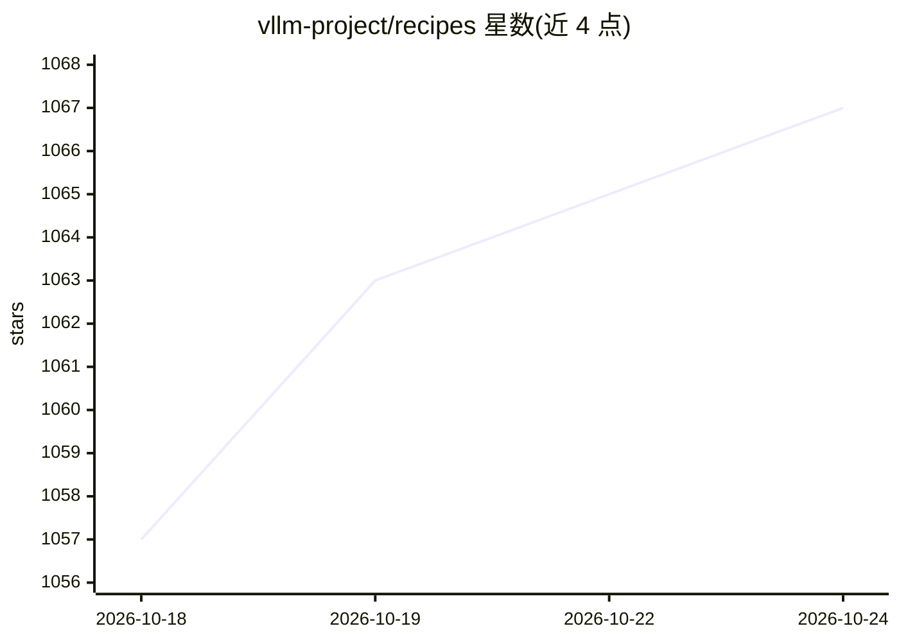

# vllm-project/recipes

⭐ 1,067 · JavaScript · Apache-2.0 · 推送 2026-10-23 · [GitHub](https://github.com/vllm-project/recipes) · [官网](https://recipes.vllm.ai) · 组织维护

**vLLM 社区维护的模型运行指南清单：模型×硬件×任务**

由 vLLM 项目维护的社区菜谱聚合仓库，回答"如何在硬件 Y 上用 vLLM 跑模型 X 完成任务 Z"。收录 DeepSeek、GLM、Qwen、Llama、Kimi、Mistral 等约 25 家厂商模型的运行指南；每条菜谱是各模型仓库维护的 YAML 文件，本仓库作为渲染器拉取合并，构建 recipes.vllm.ai 站点与 JSON API。机制上：sources.yaml 定义来源与角色，lock 文件锁定 commit 保证可复现构建，每 20 分钟自动同步并校验，失败则保留上一个有效版本。旧版 MkDocs 指南保留作参考。

## 筛选速览

| 维度 | 判定 | 备注 |
|---|---|---|
| AI 角色 | `ai-knowledge` | 知识聚合/清单类 |
| 许可风险 | `permissive` | Apache-2.0 |
| 部署形态 | `library` | 以包/库形式分发 |
| 模型依赖 | local-ok | 支持本地模型 |
| 硬件要求 | — | 无带数字的原话,不猜 |
| 安装摩擦 | `low` | 无编译、无系统依赖或容器化 |
| 成熟度 | — | 结构信号不足 |

## 能力要点

- 以 YAML 菜谱形式聚合多家模型的 vLLM 运行指南
- 渲染器架构：拉取多源 YAML 合并，生成 recipes.vllm.ai 与 JSON API
- sources.lock.json 锁定来源 commit，构建可复现，每 20 分钟自动同步校验
- 每条菜谱 JSON 带 source 字段可溯源到原仓库

## 适用场景

- 查找特定模型在指定硬件上用 vLLM 部署的命令
- 通过 JSON API 获取结构化的 vLLM 运行菜谱
- 模型维护方了解如何为本模型贡献 vLLM 运行指南

## 场景标签

 · 领域:LLM 基础设施/部署指南

## 证据(README 行号)

> L3: This repo intends to host community maintained common recipes to run vLLM answering the question:
> L122: Each recipe is a structured YAML file at `models/<hf_org>/<hf_repo>.yaml`, kept in the repository of the project t

## 星数曲线

2026-10-18 1,057 → 2026-10-24 1,067（+10）

---
*卡片 v1 · prompt 1.4 · 生成 2026-10-21 · 置信度 mid · 依据 README sha `0ce76f9f5188` · [字段定义](../../DATASET.md)*
