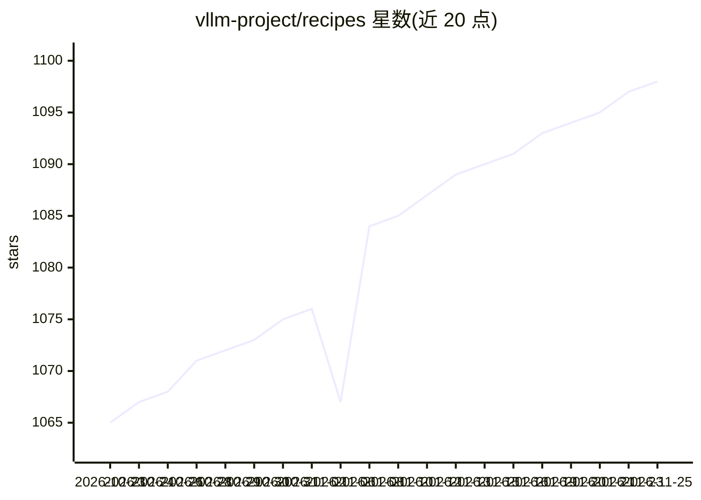

# vllm-project/recipes

⭐ 1,098 · JavaScript · Apache-2.0 · 推送 2026-11-23 · [GitHub](https://github.com/vllm-project/recipes) · [官网](https://recipes.vllm.ai) · 组织维护

**vLLM 运行配方聚合站：按模型×硬件×任务给出运行指引**

vLLM 官方生态的社区维护配方仓库，回答「如何在硬件 Y 上为任务 Z 运行模型 X」：聚合 DeepSeek、Qwen、GLM、Llama、Kimi、Ernie 等 20+ 组织的模型运行配方。每个配方为结构化 YAML 文件，存于最了解该模型的上游仓库，本仓库作为渲染器合并各来源，构建 recipes.vllm.ai 网站与 JSON API；overlay 机制按硬件品牌限制来源可添加的内容。维护方面，sources.lock.json 锁定每个远程来源的 commit，每 20 分钟自动校验更新，失败时回滚到上一个可用 commit 并自动开 issue。

## 筛选速览

| 维度 | 判定 | 备注 |
|---|---|---|
| AI 角色 | `ai-ecosystem` | LLM/agent 周边工具 |
| 许可风险 | `permissive` | Apache-2.0 |
| 部署形态 | `library` | 以包/库形式分发 |
| 模型依赖 | local-ok | 支持本地模型 |
| 硬件要求 | — | 无带数字的原话,不猜 |
| 安装摩擦 | `low` | 无编译、无系统依赖或容器化 |
| 成熟度 | — | 结构信号不足 |

## 能力要点

- 聚合 20+ 模型组织的 vLLM 运行配方（DeepSeek/Qwen/GLM/Kimi/Ernie 等）
- 配方为结构化 YAML，本仓库渲染为 recipes.vllm.ai 网站与 JSON API
- sources.lock.json 锁定来源 commit，每 20 分钟自动校验更新，失败回滚并自动开 issue
- 每个配方页带 Edit recipe 链接，JSON 携带 source 字段可溯源到 YAML

## 适用场景

- 查询某个模型在指定硬件上运行 vLLM 的命令与配置
- 通过 JSON API 程序化获取 vLLM 配方数据
- 为自家模型提交或维护 vLLM 运行配方

## 场景标签

`精选清单` · 领域:学习与行业

## 证据(README 行号)

> L3: This repo intends to host community maintained common recipes to run vLLM answering the question:
> L122: Each recipe is a structured YAML file at `models/<hf_org>/<hf_repo>.yaml`, kept in the repository of the project t

## 星数曲线

2026-10-23 1,065 → 2026-11-25 1,098（+33）

---
*卡片 v1 · prompt 1.4 · 生成 2026-11-24 · 置信度 high · 依据 README sha `78db34d4725b` · [字段定义](../../DATASET.md)*
