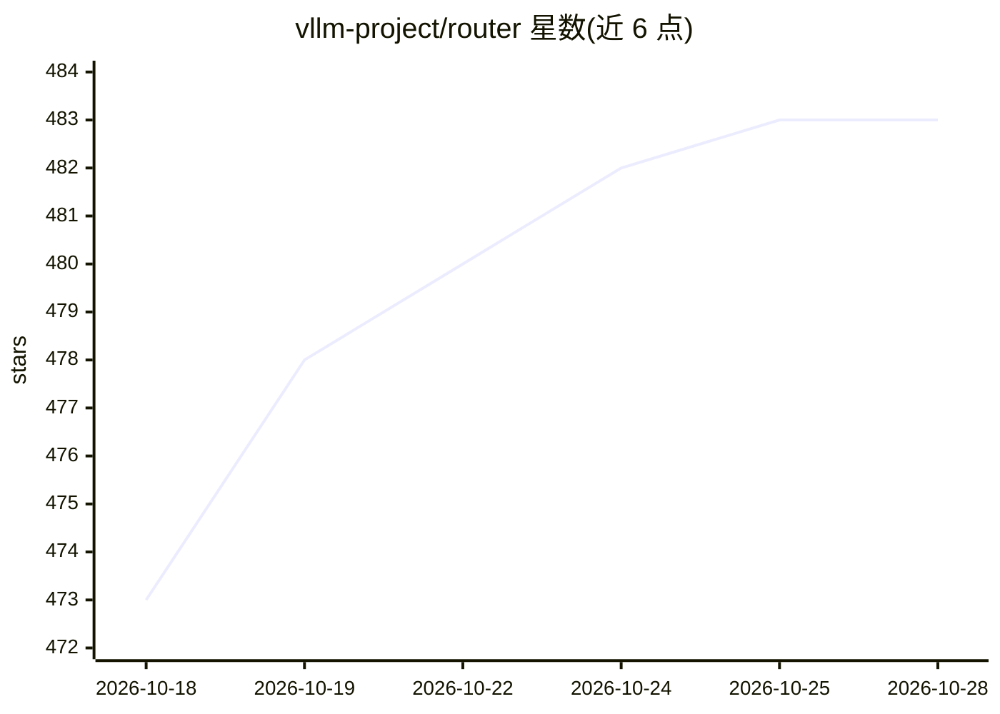

# vllm-project/router

⭐ 487 · Rust · Apache-2.0 · 推送 2026-10-28 · [GitHub](https://github.com/vllm-project/router) · 组织维护 · 中文 README

**面向 vLLM 大规模部署的请求路由与负载均衡系统**

vLLM 项目下的高性能请求转发系统：在多个 vLLM worker 之间做负载均衡（cache-aware、一致性哈希、随机、轮询等算法），支持 Prefill/Decode 分离部署的专用路由（NIXL/NCCL/Mooncake connector）、Kubernetes 服务发现与健康监控、熔断器与重试、Prometheus 指标、可选 WASM OnRequest 中间件以及面向 agent 负载的 RequestPool 准入与 Global Queue。以 Python 包（PyPI）、Rust 二进制（cargo build）或 python 启动器三种方式运行，面向大规模推理部署的运维与开发人员。

## 筛选速览

| 维度 | 判定 | 备注 |
|---|---|---|
| AI 角色 | `ai-ecosystem` | LLM/agent 周边工具 |
| 许可风险 | `permissive` | Apache-2.0 |
| 部署形态 | `library` | 以包/库形式分发 |
| 模型依赖 | local-ok | 支持本地模型 |
| 硬件要求 | — | 无带数字的原话,不猜 |
| 安装摩擦 | `medium` | 含编译或系统依赖之一 |
| 成熟度 | — | 结构信号不足 |

## 能力要点

- 多种负载均衡算法（cache-aware、一致性哈希、power of two 等）
- Prefill/Decode 分离路由，支持 NIXL/NCCL/Mooncake 连接器
- Kubernetes 服务发现、熔断器、重试与 Prometheus 指标
- 可通过 grpc:// 路由到 vLLM Rust Inference worker，支持可选 WASM 中间件

## 适用场景

- 大规模 vLLM 推理集群的多副本请求分发与负载均衡
- Prefill/Decode 分离部署场景下的阶段化路由
- Kubernetes 环境中自动发现 worker 并做健康监控与熔断

## 场景标签

`模型网关` · 领域:Agent 开发

## 证据(README 行号)

> L5: A high-performance and light-weight request forwarding system for vLLM large scale deployments, providing advanced l
> L10: - **Load Balancing**: Multiple algorithms (cache-aware, power of two, consistent hashing, random, round robin)
> L12: - **Prefill-Decode Disaggregation**: Specialized routing for separated processing phases

## 星数曲线

2026-10-18 473 → 2026-10-28 483（+10）

---
*卡片 v1 · prompt 1.4 · 生成 2026-10-21 · 置信度 high · 依据 README sha `e128ab6a10b9` · [字段定义](../../DATASET.md)*
