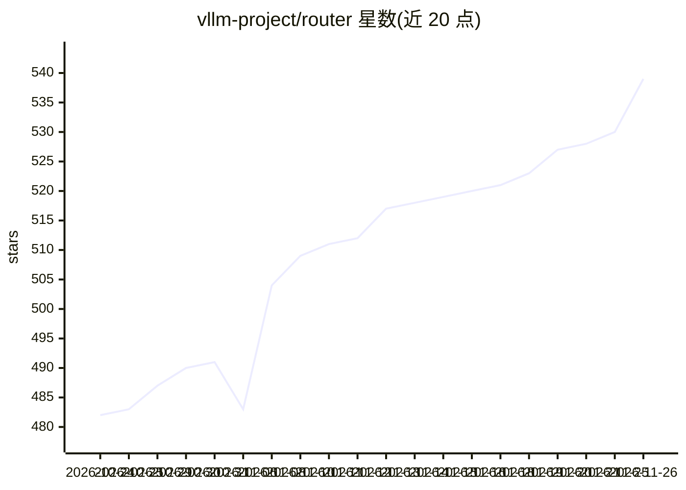

# vllm-project/router

⭐ 539 · Rust · Apache-2.0 · 推送 2026-11-25 · [GitHub](https://github.com/vllm-project/router) · 组织维护

**为 vLLM 大规模部署提供请求路由与负载均衡的系统**

面向 vLLM 大规模部署的请求转发系统，提供多种负载均衡算法（缓存感知、two-choice、一致性哈希、随机、轮询）、prefill/decode 分离路由、基于 Kubernetes 的服务发现与健康监控，以及熔断、重试、Prometheus 指标等运维功能。以 Rust 二进制为核心，附带 Python 包启动器；支持通过 grpc:// URL 路由到 vLLM Rust 推理 worker，可选 WASM 中间件插件。安装需 Rust/Cargo 与 Python/pip。

## 筛选速览

| 维度 | 判定 | 备注 |
|---|---|---|
| AI 角色 | `ai-ecosystem` | LLM/agent 周边工具 |
| 许可风险 | `permissive` | Apache-2.0 |
| 部署形态 | `library` | 以包/库形式分发 |
| 模型依赖 | local-ok | 支持本地模型 |
| 硬件要求 | — | 无带数字的原话,不猜 |
| 安装摩擦 | `medium` | 含编译或系统依赖之一 |
| 成熟度 | — | 结构信号不足 |

## 能力要点

- 多种负载均衡算法：cache-aware、一致性哈希、two-choice、随机、轮询
- 支持 prefill/decode 分离部署路由（NIXL/NCCL/Mooncake 连接器）
- Kubernetes 原生服务发现与 worker 健康监控
- 熔断器、指数退避重试、Prometheus 指标端点

## 适用场景

- 为多副本 vLLM 集群做请求分发与会话亲和
- prefill 与 decode 分离部署下的专用路由
- 在 Kubernetes 中自动发现并管理推理 worker
- 为 agent 工作负载配置请求调度与全局队列

## 场景标签

`推理引擎` · 领域:训练与推理

## 证据(README 行号)

> L5: A high-performance and light-weight request forwarding system for vLLM large scale deployments, providing advanced l
> L9: - **Core Architecture**: Request routing framework and async processing patterns
> L13: - **Service Discovery**: Kubernetes-native worker management and health monitoring

## 星数曲线

2026-10-24 482 → 2026-11-26 539（+57）

---
*卡片 v1 · prompt 1.4 · 生成 2026-11-25 · 置信度 high · 依据 README sha `51e3307407c8` · [字段定义](../../DATASET.md)*
