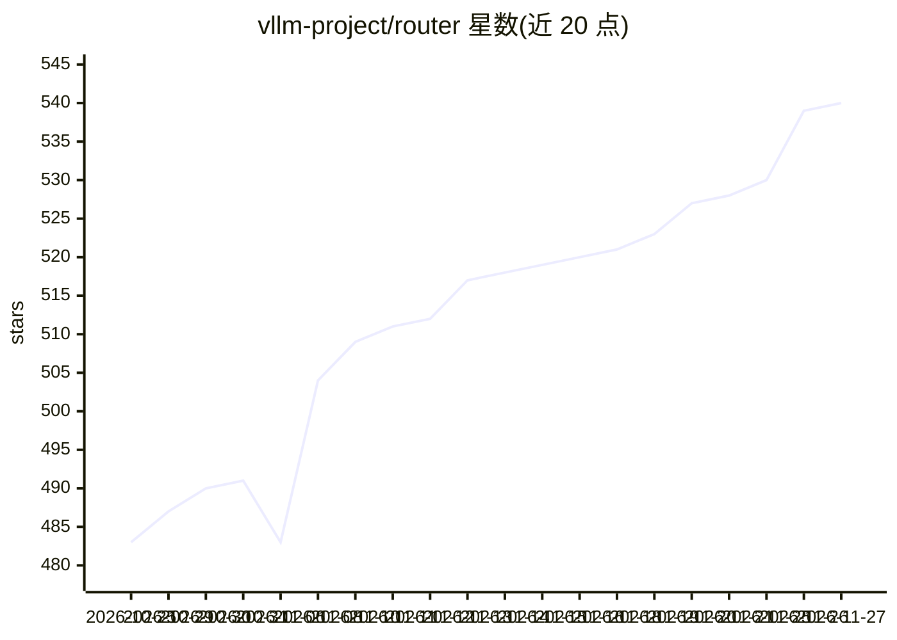

# vllm-project/router

⭐ 540 · Rust · Apache-2.0 · 推送 2026-11-26 · [GitHub](https://github.com/vllm-project/router) · 组织维护 · 中文 README

**为 vLLM 大规模部署提供的请求转发与负载均衡路由器**

vLLM Router 是面向 vLLM 大规模部署的请求转发系统，由 Rust 实现并提供 Python 包封装。功能包括多种负载均衡算法（缓存感知、两选一、一致性哈希、随机、轮询）、prefill/decode 分离架构的专用路由（支持 NIXL/NCCL/Mooncake 连接器）、Kubernetes 原生服务发现与健康监控、熔断器与重试、Prometheus 指标端点，以及可选的 WASM 中间件插件。安装支持 PyPI 的 pip 安装或源码构建，构建需要 Rust/Cargo 环境；gRPC 路由需配合 vLLM Rust 推理 worker。

## 筛选速览

| 维度 | 判定 | 备注 |
|---|---|---|
| AI 角色 | `ai-ecosystem` | LLM/agent 周边工具 |
| 许可风险 | `permissive` | Apache-2.0 |
| 部署形态 | `library` | 以包/库形式分发 |
| 模型依赖 | local-ok | 支持本地模型 |
| 硬件要求 | — | 无带数字的原话,不猜 |
| 安装摩擦 | `medium` | 含编译或系统依赖之一 |
| 成熟度 | — | 结构信号不足 |

## 能力要点

- 缓存感知、一致性哈希等 5 种负载均衡算法
- prefill/decode 分离路由，支持 NIXL/NCCL/Mooncake 连接器
- Kubernetes 原生服务发现与健康监控
- 熔断器、重试逻辑与 Prometheus 指标端点

## 适用场景

- 为多个 vLLM worker 实例做请求分发与负载均衡
- 在 Kubernetes 集群中自动发现并管理 vLLM worker
- prefill 与 decode 阶段分离部署时的流量路由
- 为 agent 工作负载配置请求队列与调度策略

## 场景标签

 · 领域:LLM 推理基础设施/部署路由

## 证据(README 行号)

> L5: A high-performance and light-weight request forwarding system for vLLM large scale deployments, providing advanced l
> L13: - **Service Discovery**: Kubernetes-native worker management and health monitoring
> L15: - **gRPC workers**: Route to vLLM Rust Inference workers via `grpc://` URLs

## 星数曲线

2026-10-25 483 → 2026-11-27 540（+57）

---
*卡片 v1 · prompt 1.4 · 生成 2026-11-26 · 置信度 high · 依据 README sha `448078dde95f` · [字段定义](../../DATASET.md)*
