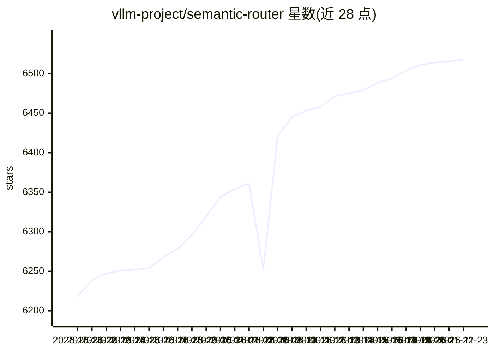

# vllm-project/semantic-router

⭐ 6,518 · Go · Apache-2.0 · 推送 2026-11-22 · [GitHub](https://github.com/vllm-project/semantic-router) · [官网](https://vllm-sr.ai) · 组织维护

**为智能体提供多模型统一 API 的可编程语义路由决策层**

vLLM 旗下的开源路由组件：为 agent harness 提供单一 API，按策略为每次调用选择或组合多个已配置的模型后端，覆盖本地、私有与云端计算，并支持按质量、延迟、成本设置优先级，以及将调用限制在批准的部署位置。agent 循环、工具与任务状态仍由用户侧 harness 承担，Router 只负责决策分发。提供 install.sh 脚本安装，pip/uv 与 agent 驱动安装见安装指南；附浏览器在线试用入口（System Duo）。

## 筛选速览

| 维度 | 判定 | 备注 |
|---|---|---|
| AI 角色 | `ai-ecosystem` | LLM/agent 周边工具 |
| 许可风险 | `permissive` | Apache-2.0 |
| 部署形态 | `None` |  |
| 模型依赖 | local-ok | 支持本地模型 |
| 硬件要求 | — | 无带数字的原话,不猜 |
| 安装摩擦 | `low` | 无编译、无系统依赖或容器化 |
| 成熟度 | — | 结构信号不足 |

## 能力要点

- 单 API 接入多模型，按策略选择或组合模型
- 支持本地/私有/云多后端与部署位置约束
- 按质量、延迟、成本优先级配置路由
- 提供 Decision/Vela 系列开源路由模型与浏览器在线试用

## 适用场景

- 让 agent harness 在多个模型后端间按任务自动路由
- 按成本与延迟优先级管理 LLM 调用
- 将模型调用限制在企业批准的部署位置

## 场景标签

`模型网关` · 领域:Agent 开发

## 证据(README 行号)

> L28: Give your agent harness one API for many models. vLLM Semantic Router selects or combines models for each call, gui
> L30: Your harness keeps the agent loop, tools, and task state. The Router chooses among configured backends across local
> L46: curl -fsSL https://vllm-sr.ai/install.sh | bash -s -- --channel stable

## 星数曲线

2026-10-21 6,218 → 2026-11-23 6,518（+300）

---
*卡片 v1 · prompt 1.4 · 生成 2026-11-22 · 置信度 high · 依据 README sha `569af8120d8b` · [字段定义](../../DATASET.md)*
