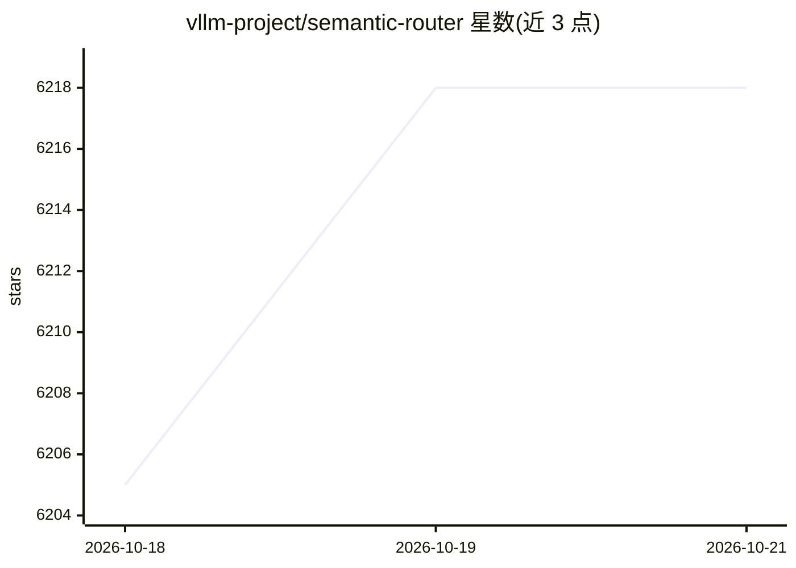

# vllm-project/semantic-router

⭐ 6,218 · Go · Apache-2.0 · 推送 2026-10-19 · [GitHub](https://github.com/vllm-project/semantic-router) · [官网](https://vllm-sr.ai) · 组织维护

**多模型智能路由决策层：按策略为每次调用选模型**

面向 agent harness 的可编程模型决策层：对外提供一个统一推理端点，依据用户设定的策略（质量、时延、成本、位置合规）在本地、私有与云端的后端间选择或组合模型；agent 侧保留循环、工具与任务状态，路由器只负责模型与算力选择。配套发布 Decision/Vela 系列开放路由基础模型，并支持幻觉检测、语义缓存等能力。通过 install.sh 脚本安装，提供在线 playground 试用。

## 筛选速览

| 维度 | 判定 | 备注 |
|---|---|---|
| AI 角色 | `ai-ecosystem` | LLM/agent 周边工具 |
| 许可风险 | `permissive` | Apache-2.0 |
| 部署形态 | `None` |  |
| 模型依赖 | local-ok | 支持本地模型 |
| 硬件要求 | — | 无带数字的原话,不猜 |
| 安装摩擦 | `low` | 无编译、无系统依赖或容器化 |
| 成熟度 | — | 结构信号不足 |

## 能力要点

- 统一 API 端点，在多后端间按策略选择或组合模型
- 支持质量/时延/成本/位置维度的优先级设置
- Decision/Vela 系列开放路由基础模型
- 内置 LettuceDetect 生成式幻觉检测端点

## 适用场景

- 让 agent 框架通过一个端点接入多个模型
- 按任务动态设置质量、时延与成本优先级
- 将推理调用限制在指定位置（边缘/私有/云端）的合规场景

## 场景标签

`模型网关` · 领域:Agent 开发

## 证据(README 行号)

> L28: Give your agent harness one API for many models. vLLM Semantic Router selects or combines models for each call, gui
> L30: Your harness keeps the agent loop, tools, and task state. The Router chooses among configured backends across local

## 星数曲线

2026-10-18 6,205 → 2026-10-21 6,218（+13）

---
*卡片 v1 · prompt 1.4 · 生成 2026-10-20 · 置信度 high · 依据 README sha `80ef7e483721` · [字段定义](../../DATASET.md)*
