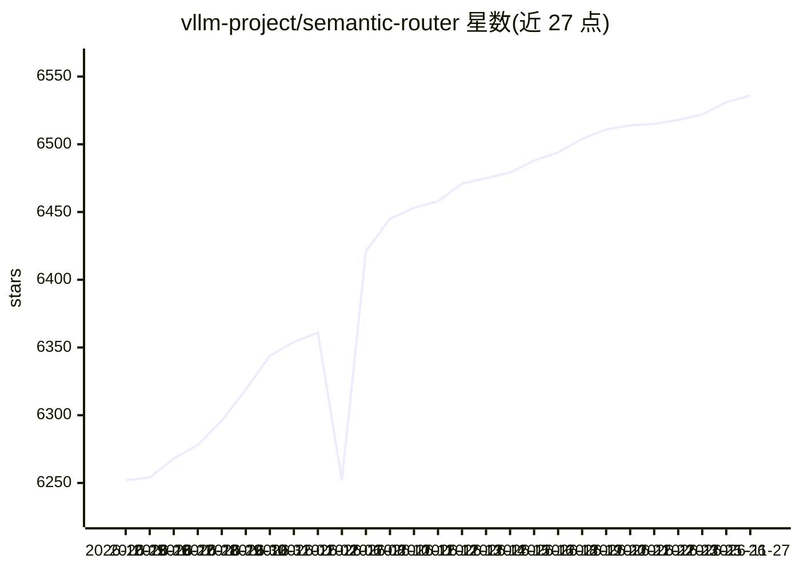

# vllm-project/semantic-router

⭐ 6,536 · Go · Apache-2.0 · 推送 2026-11-26 · [GitHub](https://github.com/vllm-project/semantic-router) · [官网](https://vllm-sr.ai) · 组织维护

**给 agent 多模型调用提供可编程路由决策层**

vLLM Semantic Router 定位为模型与算力之上的可编程决策层：为 agent harness 提供统一 API，按用户策略为每次调用选择或组合多个模型，并在本地、私有与云等已配置后端之间路由；支持按质量、延迟、成本设置优先级，约束调用保持在批准的位置。项目随附 Decision/Vela 系列路由模型与白皮书、论文，通过安装脚本或 pip/uv 安装，并提供浏览器内在线试用（System Duo）。

## 筛选速览

| 维度 | 判定 | 备注 |
|---|---|---|
| AI 角色 | `ai-ecosystem` | LLM/agent 周边工具 |
| 许可风险 | `permissive` | Apache-2.0 |
| 部署形态 | `None` |  |
| 模型依赖 | local-ok | 支持本地模型 |
| 硬件要求 | — | 无带数字的原话,不猜 |
| 安装摩擦 | `low` | 无编译、无系统依赖或容器化 |
| 成熟度 | — | 结构信号不足 |

## 能力要点

- 单一 API 路由多个模型，支持选择与组合（mixture-of-models）
- 按策略在本地、私有、云后端间路由并约束调用位置
- 随附 Decision、Vela 系列开放路由模型
- 提供幻觉检测（LettuceDetect v2）作为 vLLM endpoint

## 适用场景

- agent 应用接入多个模型并按任务自动选择或组合
- 按质量、延迟、成本优先级控制模型调用
- 将推理调用限制在私有或合规的算力位置

## 场景标签

`模型网关` · 领域:Agent 开发

## 证据(README 行号)

> L29: Give your agent harness one API for many models. vLLM Semantic Router selects or combines models for each call, gui
> L31: Your harness keeps the agent loop, tools, and task state. The Router chooses among configured backends across local

## 星数曲线

2026-10-25 6,252 → 2026-11-27 6,536（+284）

---
*卡片 v1 · prompt 1.4 · 生成 2026-11-24 · 置信度 high · 依据 README sha `1aea47a48b54` · [字段定义](../../DATASET.md)*
