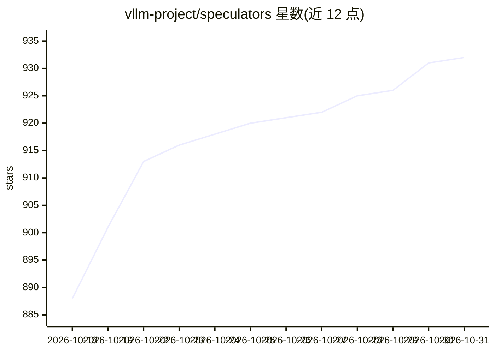

# vllm-project/speculators

⭐ 932 · Python · Apache-2.0 · 推送 2026-10-30 · [GitHub](https://github.com/vllm-project/speculators) · [官网](https://docs.vllm.ai/projects/speculators) · 组织维护

**为 vLLM 训练投机解码草稿模型的库**

面向 LLM 推理加速场景的投机解码草稿模型训练库：提供端到端框架训练草稿模型，支持 EAGLE-3/P-EAGLE、DFlash、DSpark、MTP 微调等算法，覆盖 MoE、非 MoE 与视觉语言模型。可用 vLLM 离线生成隐藏状态作为训练数据，训练产物采用 Hugging Face 兼容格式并可直接以 vllm serve 部署。提供多节点在线训练插件（文件后端与 Mooncake 后端）。以 pip 安装的 Python 库形式提供，需 Python 3.11+、Linux 或 macOS。

## 筛选速览

| 维度 | 判定 | 备注 |
|---|---|---|
| AI 角色 | `ai-ecosystem` | LLM/agent 周边工具 |
| 许可风险 | `permissive` | Apache-2.0 |
| 部署形态 | `library` | 以包/库形式分发 |
| 模型依赖 | local-ok | 支持本地模型 |
| 硬件要求 | — | 无带数字的原话,不猜 |
| 安装摩擦 | `low` | 无编译、无系统依赖或容器化 |
| 成熟度 | — | 结构信号不足 |

## 能力要点

- 支持 EAGLE-3/P-EAGLE、DFlash、DSpark、MTP 微调等草稿模型训练算法
- 训练产物采用 Hugging Face 兼容格式，可通过 vllm serve 直接部署
- 支持用 vLLM 离线生成隐藏状态训练数据
- hs_connectors 插件支持多节点在线训练（文件后端/Mooncake 后端）

## 适用场景

- 训练可与 vLLM 推理服务配合使用的投机解码草稿模型
- 将外部研究仓库的草稿模型转换为标准格式
- 对领域数据微调 Qwen3-Next 等模型的 MTP 头

## 场景标签

`微调` `推理引擎` · 领域:训练与推理

## 证据(README 行号)

> L7: Speculators is a library for training speculative decoding draft models that deploy directly to LLM inference engine
> L9: Speculators standardizes this process by providing a productionized end-to-end framework to train draft models with 

## 星数曲线

2026-10-18 888 → 2026-10-31 932（+44）

---
*卡片 v1 · prompt 1.4 · 生成 2026-10-21 · 置信度 high · 依据 README sha `cfd49648e902` · [字段定义](../../DATASET.md)*
