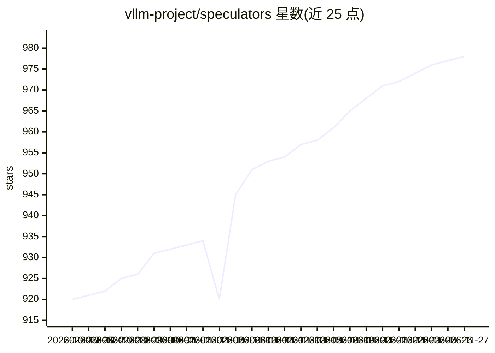

# vllm-project/speculators

⭐ 978 · Python · Apache-2.0 · 推送 2026-11-25 · [GitHub](https://github.com/vllm-project/speculators) · [官网](https://docs.vllm.ai/projects/speculators) · 组织维护

**为 vLLM 训练与部署投机解码草稿模型的库**

Speculators 提供 speculative decoding 草稿模型（speculator）的训练、评估与标准化存储流程，训练产物以 Hugging Face 兼容格式保存，可部署到 vLLM 推理引擎。机制：小模型提前起草多个 token，由大模型单次前向验证，输出无损。支持 EAGLE-3、DFlash、DSpark、P-EAGLE、MTP 微调等训练算法，MoE/非 MoE/视觉语言模型，多节点在线训练（hs_connectors），并通过 Speculators Dashboard 查看已训练模型与评测结果。限 Linux/macOS，Python 3.11+。

## 筛选速览

| 维度 | 判定 | 备注 |
|---|---|---|
| AI 角色 | `ai-ecosystem` | LLM/agent 周边工具 |
| 许可风险 | `permissive` | Apache-2.0 |
| 部署形态 | `library` | 以包/库形式分发 |
| 模型依赖 | local-ok | 支持本地模型 |
| 硬件要求 | — | 无带数字的原话,不猜 |
| 安装摩擦 | `low` | 无编译、无系统依赖或容器化 |
| 成熟度 | — | 结构信号不足 |

## 能力要点

- 端到端草稿模型训练框架，支持 EAGLE-3/DFlash/DSpark/P-EAGLE/MTP 微调算法
- Hugging Face 兼容的标准化格式，可转换外部研究仓库的模型
- 训练模型经 vllm serve 命令直接部署到 vLLM
- 多节点在线训练（文件/Mooncake 后端传输 hidden states）

## 适用场景

- 为生产推理服务器训练自定义投机解码草稿模型
- 在领域数据上微调 MTP 头提升草稿接受率
- 浏览 Speculators Dashboard 选择现成的 speculator 模型

## 场景标签

`微调` `模型训练` `模型评测` · 领域:评测与运维

## 证据(README 行号)

> L7: Speculators is a library for training speculative decoding draft models that deploy directly to LLM inference engine
> L42: - **Seamless vLLM Integration:** Built for direct deployment into vLLM, enabling low-latency, production-grade infe

## 星数曲线

2026-10-25 920 → 2026-11-27 978（+58）

---
*卡片 v1 · prompt 1.4 · 生成 2026-11-24 · 置信度 high · 依据 README sha `9bde88fdba02` · [字段定义](../../DATASET.md)*
