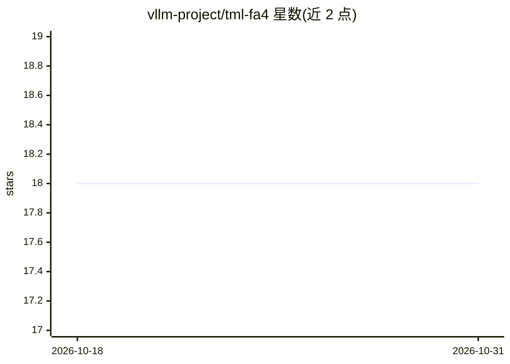

# vllm-project/tml-fa4

⭐ 18 · Python · BSD-3-Clause · 推送 2026-09-11 · [GitHub](https://github.com/vllm-project/tml-fa4) · 组织维护

**FlashAttention-4 前向注意力 CUDA 内核库（CuTeDSL）**

由 TML 与 Colfax 合作开发的 FlashAttention-4 前向注意力内核，基于 CuTeDSL 实现，保留相对偏置剪切、split-KV 合并、调度器元数据、mask/score 修改器、block-sparse 支持及 SM100 hd256 前向内核。提供 flash_attn_func / flash_attn_varlen_func 公开接口，仅返回前向输出，输入可带梯度但输出未接入反向内核。通过 attention 后端 SPI 传入 ragged 相对偏置张量，要求 CUDA 设备且 rel_extent 为 128 的倍数。以 pip 可编辑安装方式提供，面向深度学习推理/训练栈开发者。

## 筛选速览

| 维度 | 判定 | 备注 |
|---|---|---|
| AI 角色 | `ai-ecosystem` | LLM/agent 周边工具 |
| 许可风险 | `permissive` | BSD-3-Clause |
| 部署形态 | `library` | 以包/库形式分发 |
| 模型依赖 | — | README 未给出锁定关系 |
| 硬件要求 | — | 无带数字的原话,不猜 |
| 安装摩擦 | `medium` | 含编译或系统依赖之一 |
| 成熟度 | — | 结构信号不足 |

## 能力要点

- 基于 CuTeDSL 的 FlashAttention-4 前向注意力内核
- 支持 ragged 相对偏置、block-sparse、split-KV 合并
- 包含 SM100 hd256 前向内核
- 仅前向输出，未接线 FA4 反向内核

## 适用场景

- 为模型推理栈替换 FlashAttention 前向注意力路径
- 在注意力计算中加入相对位置偏置
- 在 SM100（Blackwell）硬件上运行 hd256 前向注意力

## 场景标签

`推理引擎` · 领域:训练与推理

## 证据(README 行号)

> L1: # FlashAttention-4 Forward
> L5: This repo keeps the FA4 forward attention paths, including relative bias shearing, split-KV combine, scheduler metad

## 星数曲线

2026-10-18 18 → 2026-10-31 18（+0）

---
*卡片 v1 · prompt 1.4 · 生成 2026-10-29 · 置信度 high · 依据 README sha `4b11da3a94fd` · [字段定义](../../DATASET.md)*
