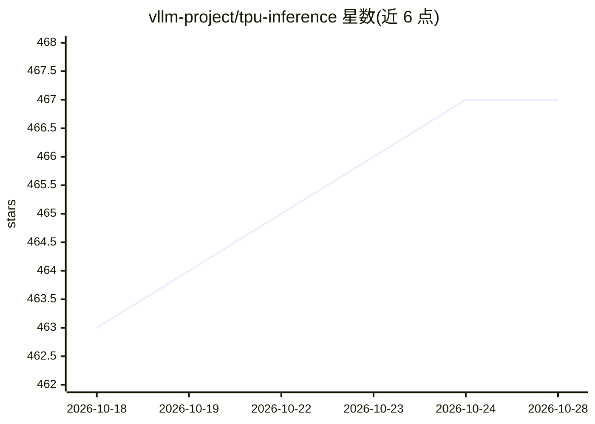

# vllm-project/tpu-inference

⭐ 468 · Python · Apache-2.0 · 推送 2026-10-28 · [GitHub](https://github.com/vllm-project/tpu-inference) · [官网](https://docs.vllm.ai/projects/tpu) · 组织维护

**在 Google TPU 上以 vLLM 服务 JAX/PyTorch 模型的统一后端**

vllm-jax（原 tpu-inference）是 vLLM 项目内的硬件插件，通过单一 lowering 路径在 TPU 上统一支持 JAX 与 PyTorch：PyTorch 模型定义无需改码即可在 TPU 上运行，同时扩展 JAX 原生支持，并保留 vLLM 的用户体验、遥测与接口。推荐 TPU 代次为 v7x/v5e/v6e（v3/v4/v5p 为实验性）。README 提供模型/特性/内核支持矩阵，涵盖投机解码、P/D 分离、多量化格式；核心组件仍在实现过程中。仓库正在迁移至 vllm-project/vllm-jax，PyTorch 原生 TPU 服务已分拆至 vllm-torchtpu。

## 筛选速览

| 维度 | 判定 | 备注 |
|---|---|---|
| AI 角色 | `ai-ecosystem` | LLM/agent 周边工具 |
| 许可风险 | `permissive` | Apache-2.0 |
| 部署形态 | `None` |  |
| 模型依赖 | local-ok | 支持本地模型 |
| 硬件要求 | — | 无带数字的原话,不猜 |
| 安装摩擦 | `low` | 无编译、无系统依赖或容器化 |
| 成熟度 | `idea` | |

## 能力要点

- 单一 lowering 路径统一 JAX 与 PyTorch 在 TPU 上的运行
- 保留 vLLM 标准接口、遥测与用户体验
- 提供 Release/Nightly 两级模型、特性与内核支持矩阵（自动更新）
- 支持投机解码（Eagle3/Ngram/DFlash）、P/D 分离、KV Cache 卸载、多量化格式

## 适用场景

- 在 TPU 集群上用 vLLM 服务已验证的 LLM/多模态模型
- 让 PyTorch 模型定义不改代码运行于 TPU
- 查各 TPU 代次上模型与特性的支持状态以规划部署

## 场景标签

`推理引擎` · 领域:训练与推理

## 证据(README 行号)

> L32: vLLM JAX is powered by `vllm-jax` (formerly `tpu-inference`), an expressive and powerful new hardware plugin unifyi
> L35: - Provide more flexibility to JAX and PyTorch users by running PyTorch model definitions performantly on TPU withou
> L36: - Retain vLLM standardization: keep the same user experience, telemetry, and interface.

## 星数曲线

2026-10-18 463 → 2026-10-28 467（+4）

---
*卡片 v1 · prompt 1.4 · 生成 2026-10-21 · 置信度 high · 依据 README sha `bcd99613ed17` · [字段定义](../../DATASET.md)*
