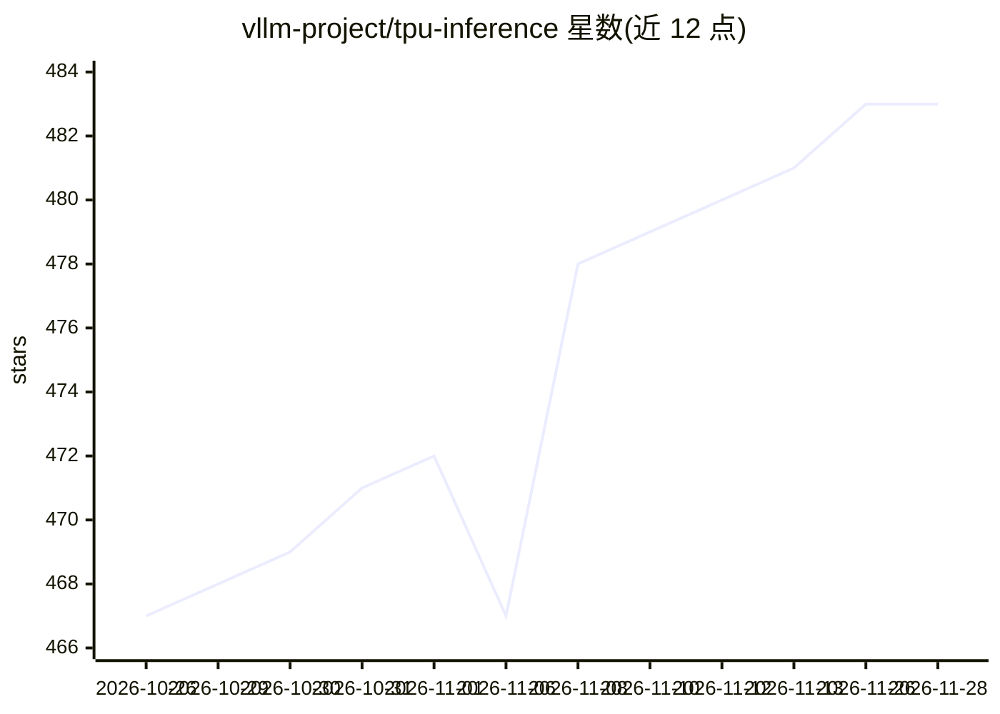

# vllm-project/tpu-inference

⭐ 483 · Python · Apache-2.0 · 推送 2026-11-27 · [GitHub](https://github.com/vllm-project/tpu-inference) · [官网](https://docs.vllm.ai/projects/tpu) · 组织维护

**vLLM 的 TPU 推理后端，聚焦 JAX 模型服务**

vLLM 项目下的 TPU 硬件插件，原名 tpu-inference，现迁往 vllm-project/vllm-jax，聚焦以 vLLM 在 TPU 上服务 JAX 模型；PyTorch 原生 TPU 服务已拆分至 vllm-torchtpu。提供统一 lowering 路径，使 PyTorch 模型定义无需改动即可在 TPU 上运行，同时扩展 JAX 原生支持。README 以支持矩阵形式公布经单测、集成与性能测试验证的推荐模型与特性清单，覆盖 v7x/v5e/v6e 等代际，安装与快速入门指向外部文档。

## 筛选速览

| 维度 | 判定 | 备注 |
|---|---|---|
| AI 角色 | `ai-ecosystem` | LLM/agent 周边工具 |
| 许可风险 | `permissive` | Apache-2.0 |
| 部署形态 | `None` |  |
| 模型依赖 | local-ok | 支持本地模型 |
| 硬件要求 | — | 无带数字的原话,不猜 |
| 安装摩擦 | `low` | 无编译、无系统依赖或容器化 |
| 成熟度 | — | 结构信号不足 |

## 能力要点

- 统一 JAX 与 PyTorch 的单一 lowering 路径硬件插件
- 发布 TPU 支持矩阵仪表盘（模型/特性/内核状态，自动更新）
- 支持 speculative decoding（Eagle3/Ngram/DFlash）、prefix caching、P/D 分离等特性
- 兼容 TPU 代际：推荐 v7x/v5e/v6e，实验性 v3/v4/v5p

## 适用场景

- 在 Google TPU 上以 vLLM 服务大模型推理
- 将 PyTorch 模型定义不加改动地跑在 TPU 上
- 按支持矩阵核查目标模型与特性在 TPU 上的验证状态

## 场景标签

`推理引擎` · 领域:训练与推理

## 证据(README 行号)

> L8: > **`tpu-inference` is now vLLM JAX (`vllm-jax`)** and is focused on serving JAX models on TPU with vLLM.
> L10: > This repository is moving to **vllm-project/vllm-jax**. Until the move is complete, development continues in vllm
> L32: vLLM JAX is powered by `vllm-jax` (formerly `tpu-inference`), an expressive and powerful new hardware plugin unifyi

## 星数曲线

2026-10-26 467 → 2026-11-28 483（+16）

---
*卡片 v1 · prompt 1.4 · 生成 2026-11-25 · 置信度 high · 依据 README sha `b2cd6c9cf4fe` · [字段定义](../../DATASET.md)*
