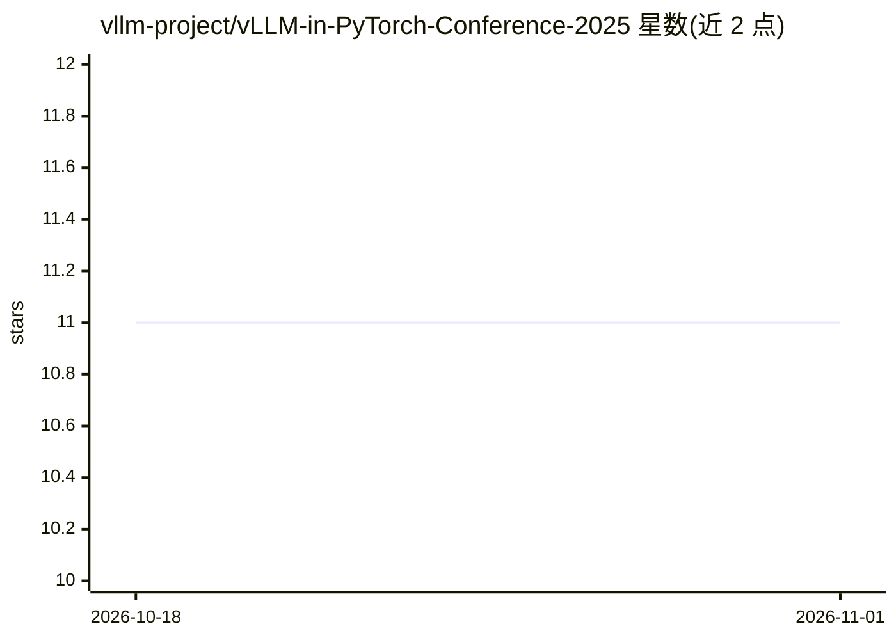

# vllm-project/vLLM-in-PyTorch-Conference-2025

⭐ 11 · 推送 2025-12-14 · [GitHub](https://github.com/vllm-project/vLLM-in-PyTorch-Conference-2025) · 组织维护

**PyTorch 大会 2025 中提及 vLLM 的演讲视频清单**

由 vLLM 项目维护的会议视频策展清单：从 PyTorch Conference 2025 全部 117 个视频中筛选出至少 53 个提及 vLLM 的视频，按大会编号列出标题、演讲者与详情链接，覆盖 vLLM 硬件适配、推理服务、KV Cache 扩展等主题。清单声明非穷尽，欢迎通过 pull request 补充新条目。纯列表型仓库，无代码或安装步骤。

## 筛选速览

| 维度 | 判定 | 备注 |
|---|---|---|
| AI 角色 | `ai-knowledge` | 知识聚合/清单类 |
| 许可风险 | `none` | — |
| 部署形态 | `None` |  |
| 模型依赖 | — | README 未给出锁定关系 |
| 硬件要求 | — | 无带数字的原话,不猜 |
| 安装摩擦 | `low` | 无编译、无系统依赖或容器化 |
| 成熟度 | — | 结构信号不足 |

## 能力要点

- 从 117 个大会视频中筛出 53 个提及 vLLM 的视频（占比约 45%）
- 按演讲编号列出标题、演讲者与详情链接
- 开放 pull request 补充遗漏条目

## 适用场景

- 查找关于 vLLM 的会议演讲视频
- 了解 vLLM 在 PyTorch 生态演讲中的覆盖情况
- 跟踪 vLLM 硬件适配与推理服务相关进展的演讲入口

## 场景标签

`精选清单` · 领域:学习与行业

## 证据(README 行号)

> L1: # vLLM-in-PyTorch-Conference-2025
> L3: There are at least 53 videos (out of the full 117 videos in PyTorch conference 2025) mentioning vLLM. The ratio is 4

## 星数曲线

2026-10-18 11 → 2026-11-01 11（+0）

---
*卡片 v1 · prompt 1.4 · 生成 2026-11-01 · 置信度 high · 依据 README sha `f1a35bb36694` · [字段定义](../../DATASET.md)*
