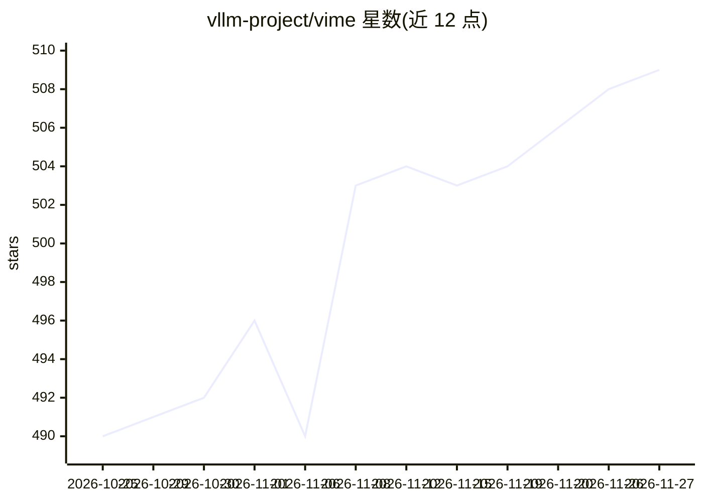

# vllm-project/vime

⭐ 509 · Python · Apache-2.0 · 推送 2026-11-26 · [GitHub](https://github.com/vllm-project/vime) · 组织维护 · 中文 README

**面向 RL scaling 的 LLM 后训练框架，基于 slime 与 vLLM**

Vime 是由 vLLM 社区维护的 LLM 强化学习后训练框架，构建于 slime 之上，保留其训练栈与数据生成设计，默认以 vLLM（含 vllm-router）作为 rollout 后端。训练（Megatron）、rollout、数据缓冲与环境反馈共享同一数据流，可在同一训练循环中支持数学、代码、搜索、工具使用与长程 agent 任务。模型支持继承自 slime（Qwen、DeepSeek V3 系列、Llama 3）；文档提供快速入门指南，仓库内含中英文文档。

## 筛选速览

| 维度 | 判定 | 备注 |
|---|---|---|
| AI 角色 | `ai-ecosystem` | LLM/agent 周边工具 |
| 许可风险 | `permissive` | Apache-2.0 |
| 部署形态 | `None` |  |
| 模型依赖 | local-ok | 支持本地模型 |
| 硬件要求 | — | 无带数字的原话,不猜 |
| 安装摩擦 | `low` | 无编译、无系统依赖或容器化 |
| 成熟度 | — | 结构信号不足 |

## 能力要点

- Megatron 训练与 vLLM rollout 连接的高性能训练路径
- 通过自定义数据生成接口与 server 引擎实现任意训练数据生成流程
- 支持多智能体、全异步 rollout、编码 agent RL 等示例
- 保留 Megatron/vLLM 原生参数面（--vllm-、--router- 前缀透传）

## 适用场景

- 为 Qwen、DeepSeek 等开源模型搭建 RL 后训练流程
- 跑通数学、代码、搜索、工具使用类 RL 训练任务
- 长程 agent 工作流的多轮 rollout 与沙箱交互训练
- 在 vLLM 生态内寻找 slime 训练范式的落地路径

## 场景标签

`强化学习` · 领域:训练与推理

## 证据(README 行号)

> L8: **Vime** is an LLM training framework for RL scaling, built on slime. It keeps slime's training stack and data-gener
> L28: The vLLM community horizontally supports many LLM post-training frameworks, including (in alphabetical order) NeMo 
> L143: Vime builds on ideas and infrastructure from the open-source RL ecosystem. We especially thank the slime community

## 星数曲线

2026-10-25 490 → 2026-11-27 509（+19）

---
*卡片 v1 · prompt 1.4 · 生成 2026-11-25 · 置信度 high · 依据 README sha `cc07c2af9a61` · [字段定义](../../DATASET.md)*
