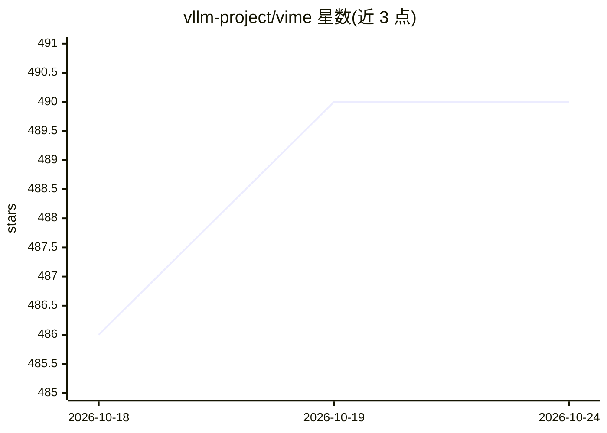

# vllm-project/vime

⭐ 490 · Python · Apache-2.0 · 推送 2026-10-14 · [GitHub](https://github.com/vllm-project/vime) · 组织维护 · 中文 README

**面向 RL scaling 的 LLM 后训练框架，基于 slime + vLLM**

由 vLLM 社区维护的 LLM 后训练框架，从 slime 衍生：保留其训练栈与数据生成设计，以 vLLM（含 vllm-router）作为默认 rollout 后端，将 Megatron 训练与 vLLM 推理连接。训练、rollout、数据缓冲与环境反馈共享同一数据流，支持数学、代码、搜索、工具调用与长程 agent 工作流在同一训练循环内完成。提供 PD 分离、外部 rollout 引擎、增量权重同步等部署选项；模型支持 Qwen 系列、DeepSeek V3 系列与 Llama 3。

## 筛选速览

| 维度 | 判定 | 备注 |
|---|---|---|
| AI 角色 | `ai-ecosystem` | LLM/agent 周边工具 |
| 许可风险 | `permissive` | Apache-2.0 |
| 部署形态 | `None` |  |
| 模型依赖 | local-ok | 支持本地模型 |
| 硬件要求 | — | 无带数字的原话,不猜 |
| 安装摩擦 | `low` | 无编译、无系统依赖或容器化 |
| 成熟度 | — | 结构信号不足 |

## 能力要点

- Megatron 训练与 vLLM rollout 引擎的连接，含 vllm-router 请求路由
- 训练/rollout/数据缓冲/环境反馈共享单一数据流
- 支持多智能体、全异步 rollout、coding-agent RL 等示例与自定义生成接口
- 支持 PD 分离、多模型服务、增量权重同步与外部 rollout 引擎

## 适用场景

- 对 Qwen/DeepSeek/Llama 模型做 RL 后训练
- 构建含工具调用与环境交互的 agentic RL 训练流程
- 用 vLLM 生态做大规模 rollout 的 RL scaling 实验

## 场景标签

`强化学习` · 领域:训练与推理

## 证据(README 行号)

> L8: **Vime** is an LLM post-training framework for RL scaling, built on slime. It keeps slime's training stack and data-
> L143: Vime builds on ideas and infrastructure from the open-source RL ecosystem. We especially thank the slime community

## 星数曲线

2026-10-18 486 → 2026-10-24 490（+4）

---
*卡片 v1 · prompt 1.4 · 生成 2026-10-21 · 置信度 high · 依据 README sha `5b07bfd3a58c` · [字段定义](../../DATASET.md)*
