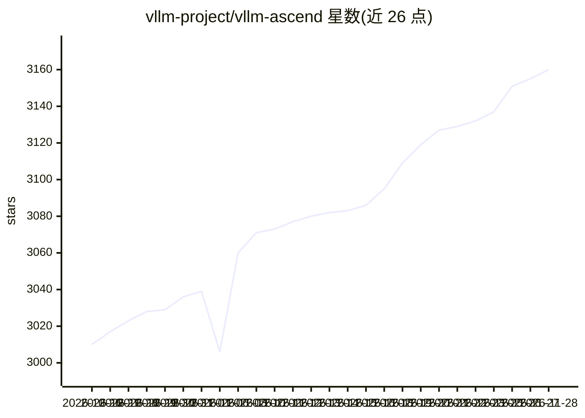

# vllm-project/vllm-ascend

⭐ 3,160 · Python · Apache-2.0 · 推送 2026-11-27 · [GitHub](https://github.com/vllm-project/vllm-ascend) · [官网](https://docs.vllm.ai/projects/ascend) · 组织维护 · 中文 README

**让 vLLM 在华为昇腾 NPU 上运行的社区硬件插件**

由 vLLM 社区官方维护的硬件插件，遵循 vLLM Hardware pluggable RFC，提供可插拔硬件接口，将昇腾 NPU 与 vLLM 的集成解耦。通过该插件，Transformer 类、MoE、Embedding 及多模态大模型可在 Ascend NPU 上运行。README 给出硬件、OS、Python/CANN/PyTorch/TorchNPU/vLLM 版本前提，区分 main 与 releases 分支，并通过昇腾 CI 持续做质量监控，附周会与用户案例页。

## 筛选速览

| 维度 | 判定 | 备注 |
|---|---|---|
| AI 角色 | `ai-ecosystem` | LLM/agent 周边工具 |
| 许可风险 | `permissive` | Apache-2.0 |
| 部署形态 | `None` |  |
| 模型依赖 | local-ok | 支持本地模型 |
| 硬件要求 | — | 无带数字的原话,不猜 |
| 安装摩擦 | `low` | 无编译、无系统依赖或容器化 |
| 成熟度 | — | 结构信号不足 |

## 能力要点

- 遵循 vLLM Hardware pluggable RFC 的硬件可插拔接口
- 支持 Transformer、MoE、Embedding、多模态 LLM 在昇腾 NPU 运行
- main/releases 分支与 vLLM 版本对齐，昇腾 CI 持续监控质量
- 提供 Support Matrix、QuickStart 文档与用户案例页

## 适用场景

- 在 Atlas 800I A2/A3、950 系列昇腾硬件上部署大模型推理服务
- 为微调/评测/强化学习场景接入昇腾算力（配合 LLaMA-Factory/verl/TRL/GPUStack）
- 基于昇腾环境对 vllm-ascend 做二次开发

## 场景标签

`推理引擎` · 领域:训练与推理

## 证据(README 行号)

> L32: vLLM Ascend (`vllm-ascend`) is a community maintained hardware plugin for running vLLM seamlessly on the Huawei Asc
> L34: It is the recommended approach for supporting the Ascend backend within the vLLM community. It adheres to the princ

## 星数曲线

2026-10-26 3,010 → 2026-11-28 3,160（+150）

---
*卡片 v1 · prompt 1.4 · 生成 2026-11-26 · 置信度 high · 依据 README sha `d780c329576a` · [字段定义](../../DATASET.md)*
