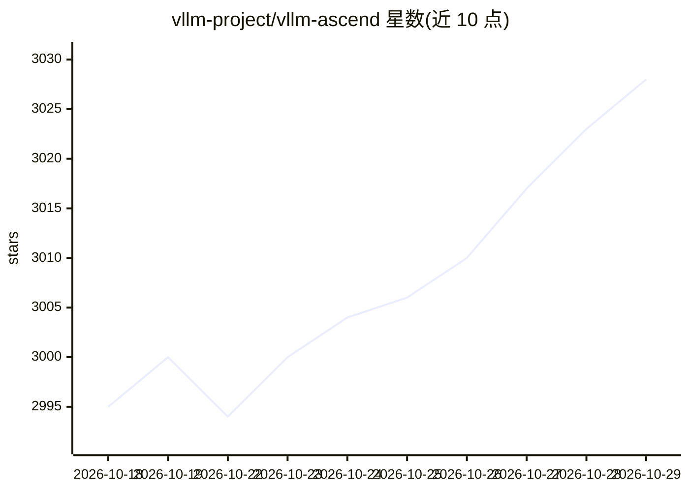

# vllm-project/vllm-ascend

⭐ 3,028 · Python · Apache-2.0 · 推送 2026-10-28 · [GitHub](https://github.com/vllm-project/vllm-ascend) · [官网](https://docs.vllm.ai/projects/ascend) · 组织维护 · 中文 README

**让 vLLM 在华为昇腾 NPU 上运行的社区维护硬件插件**

vllm-ascend 是 vLLM 官方仓库下的社区维护硬件插件，遵循 vLLM 硬件可插拔 RFC，将昇腾 NPU 后端与 vLLM 解耦集成，使 Transformer 类、MoE、Embedding、多模态 LLM 等开源模型可在昇腾 NPU 上运行。支持 Atlas 800I A2/A3、A2/A3 训练系列等硬件，要求 Linux、Python 3.10-3.12、CANN 9.1.0、PyTorch/TorchNPU 及同版本 vLLM；提供 main/dev 分支与多版本维护，通过 HiDevLab 可申请 NPU 资源。Apache 2.0 许可。

## 筛选速览

| 维度 | 判定 | 备注 |
|---|---|---|
| AI 角色 | `ai-ecosystem` | LLM/agent 周边工具 |
| 许可风险 | `permissive` | Apache-2.0 |
| 部署形态 | `None` |  |
| 模型依赖 | local-ok | 支持本地模型 |
| 硬件要求 | — | 无带数字的原话,不猜 |
| 安装摩擦 | `low` | 无编译、无系统依赖或容器化 |
| 成熟度 | — | 结构信号不足 |

## 能力要点

- 实现 vLLM 硬件可插拔接口，接入昇腾 NPU 后端
- 支持 Transformer 类、MoE、Embedding、多模态 LLM 运行
- 多版本分支维护并由昇腾 CI 持续质量监控
- 可通过 HiDevLab 在线申请昇腾 NPU 开发测试资源

## 适用场景

- 在昇腾 NPU 硬件上部署 vLLM 推理服务
- 国产算力环境下运行开源大模型
- 配合微调/评测/强化学习流程使用昇腾推理后端

## 场景标签

`推理引擎` · 领域:训练与推理

## 证据(README 行号)

> L32: vLLM Ascend (`vllm-ascend`) is a community maintained hardware plugin for running vLLM seamlessly on the Ascend NPU
> L34: It is the recommended approach for supporting the Ascend backend within the vLLM community. It adheres to the princ

## 星数曲线

2026-10-18 2,995 → 2026-10-29 3,028（+33）

---
*卡片 v1 · prompt 1.4 · 生成 2026-10-20 · 置信度 high · 依据 README sha `ff7f011060b4` · [字段定义](../../DATASET.md)*
