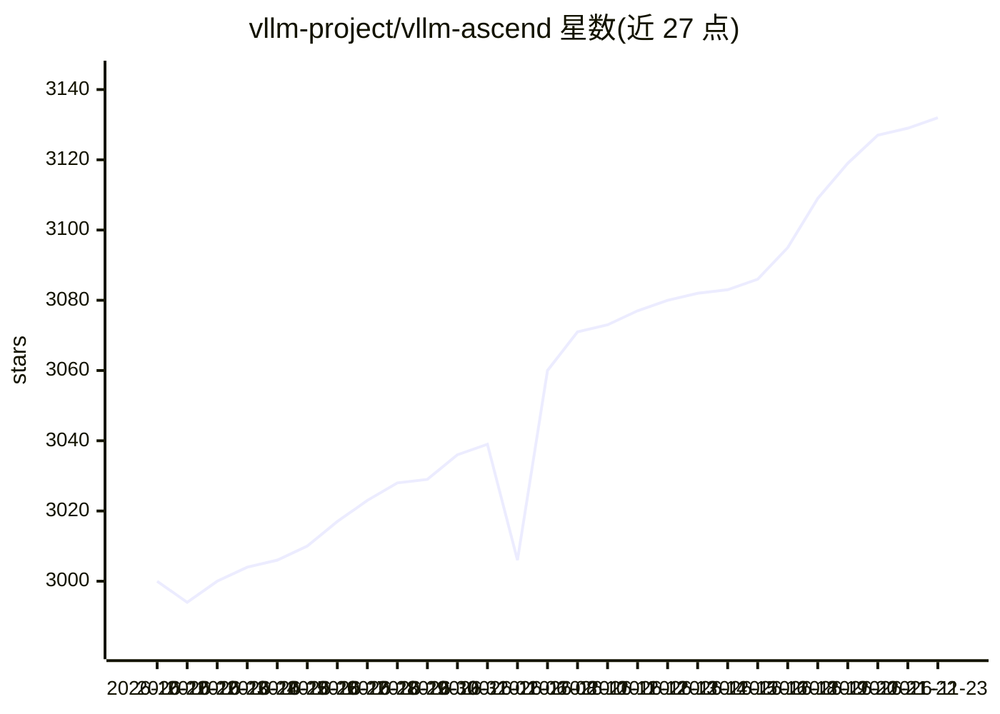

# vllm-project/vllm-ascend

⭐ 3,132 · Python · Apache-2.0 · 推送 2026-11-22 · [GitHub](https://github.com/vllm-project/vllm-ascend) · [官网](https://docs.vllm.ai/projects/ascend) · 组织维护

**让 vLLM 在华为昇腾 NPU 上运行的社区硬件插件**

vllm-ascend 是 vLLM 社区维护的硬件插件，依据 vLLM 的 Hardware pluggable RFC 提供可插拔硬件接口，将昇腾 NPU 与 vLLM 的集成解耦。通过该插件，Transformer 类、MoE、Embedding 及多模态 LLM 可在昇腾 NPU 上运行。前置条件包括 Atlas 系列硬件、Linux、Python 3.12、CANN 9.2.1、PyTorch/TorchNPU 2.10.0，且需安装与插件同版本的 vLLM。版本随 vLLM 发布节奏对齐，设有 main 与 releases 分支并通过 Ascend CI 监测质量。

## 筛选速览

| 维度 | 判定 | 备注 |
|---|---|---|
| AI 角色 | `ai-ecosystem` | LLM/agent 周边工具 |
| 许可风险 | `permissive` | Apache-2.0 |
| 部署形态 | `None` |  |
| 模型依赖 | local-ok | 支持本地模型 |
| 硬件要求 | — | 无带数字的原话,不猜 |
| 安装摩擦 | `low` | 无编译、无系统依赖或容器化 |
| 成熟度 | — | 结构信号不足 |

## 能力要点

- 依据 vLLM Hardware pluggable RFC 提供硬件可插拔接口
- 支持 Transformer、MoE、Embedding、多模态 LLM 在昇腾 NPU 上运行
- 分支与 vLLM 版本对齐，经 Ascend CI 持续质量监测
- 提供社区与 AI 共同维护的 DeepWiki 技术知识库

## 适用场景

- 在华为昇腾 NPU 环境部署 vLLM 推理服务
- 在昇腾硬件上运行 MoE 或多模态大模型
- 参与 vLLM 昇腾后端适配的二次开发

## 场景标签

`推理引擎` · 领域:训练与推理

## 证据(README 行号)

> L32: vLLM Ascend (`vllm-ascend`) is a community maintained hardware plugin for running vLLM seamlessly on the Huawei Asc
> L34: It is the recommended approach for supporting the Ascend backend within the vLLM community. It adheres to the princ

## 星数曲线

2026-10-21 3,000 → 2026-11-23 3,132（+132）

---
*卡片 v1 · prompt 1.4 · 生成 2026-11-23 · 置信度 high · 依据 README sha `a8cc0222ae6c` · [字段定义](../../DATASET.md)*
