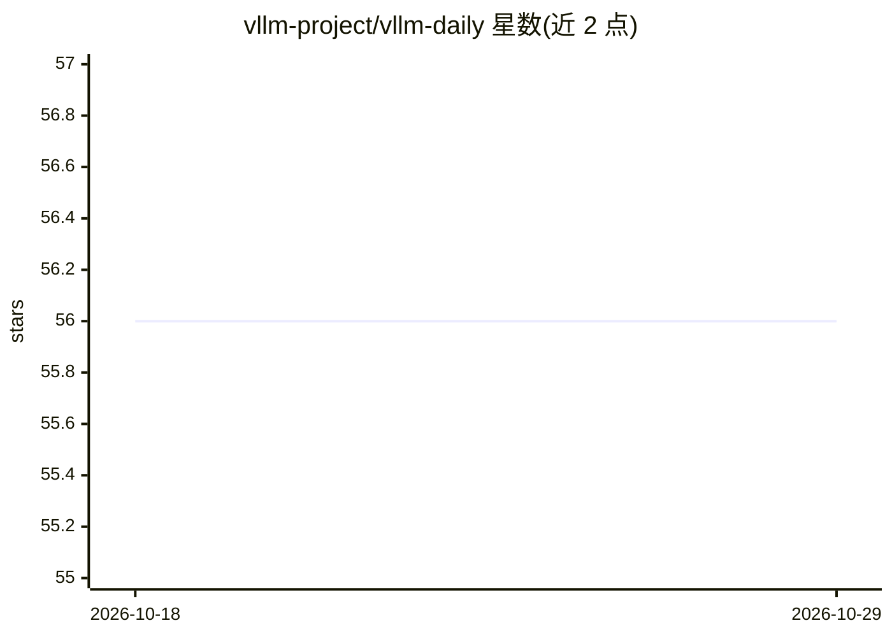

# vllm-project/vllm-daily

⭐ 56 · 推送 2026-10-28 · [GitHub](https://github.com/vllm-project/vllm-daily) · 组织维护

**vLLM 已合并 PR 的每日汇总仓库，可订阅 RSS**

vllm-project 维护的自动化仓库，按日汇总 vLLM 主仓库中已合并 PR 的内容，供关注 vLLM 演进的开发者查阅变更记录。README 提供订阅方式：使用仓库 commits/main.atom 地址作为 RSS 源接收日报更新。除订阅提示外，README 未说明其他使用或安装方式，条目由工作流生成。

## 筛选速览

| 维度 | 判定 | 备注 |
|---|---|---|
| AI 角色 | `ai-knowledge` | 知识聚合/清单类 |
| 许可风险 | `none` | — |
| 部署形态 | `None` |  |
| 模型依赖 | — | README 未给出锁定关系 |
| 硬件要求 | — | 无带数字的原话,不猜 |
| 安装摩擦 | `low` | 无编译、无系统依赖或容器化 |
| 成熟度 | — | 结构信号不足 |

## 能力要点

- 按日汇总 vLLM 已合并 PR
- 提供 main.atom 地址作为 RSS 订阅源
- 由 vllm-project 组织维护

## 适用场景

- 跟踪 vLLM 上游的每日变更与合并情况
- 通过 RSS 订阅 vLLM 日报更新

## 场景标签

 · 领域:LLM 基础设施/资讯聚合

## 证据(README 行号)

> L1: # vllm-daily
> L2: vLLM Daily Summarization of Merged PRs

## 星数曲线

2026-10-18 56 → 2026-10-29 56（+0）

---
*卡片 v1 · prompt 1.4 · 生成 2026-10-24 · 置信度 mid · 依据 README sha `32ba40a485fe` · [字段定义](../../DATASET.md)*
