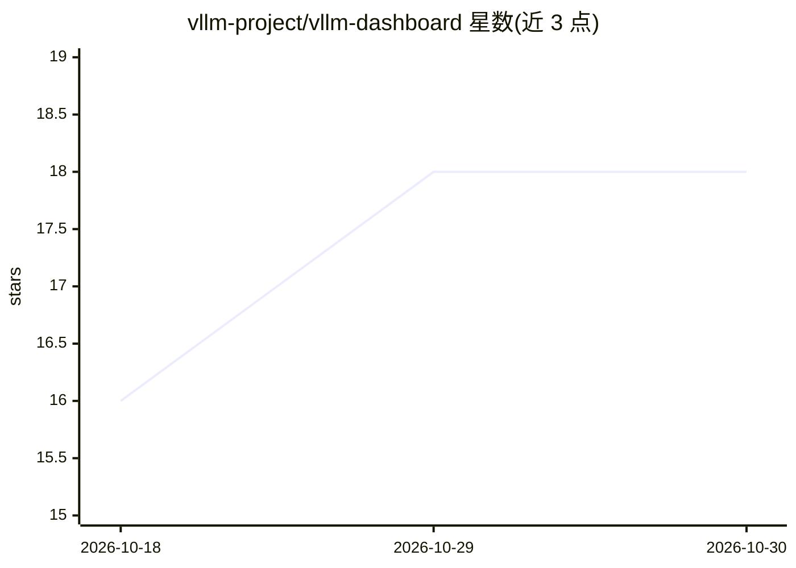

# vllm-project/vllm-dashboard

⭐ 18 · TypeScript · 推送 2026-10-29 · [GitHub](https://github.com/vllm-project/vllm-dashboard) · [官网](https://vllm-ci-dashboard.vercel.app) · 组织维护

**观测 vLLM Buildkite CI 的 Next.js 仪表盘：构建、队列、成本与性能趋势**

面向 vLLM 项目的 CI 可观测性仪表盘，基于 Next.js（App Router）部署于 Vercel，数据来自 Buildkite GraphQL/REST API、Databricks SQL Warehouse、Postgres（Supabase）与 GitHub API。页面覆盖构建通过率、作业失败与重试、告警、测试可靠性、NVIDIA/AMD 测试镜像对齐（Parity）、队列深度、按 AWS 按需价格折算的计算成本、性能基准趋势与基线/候选镜像对比。另有独立 Python 告警 worker、OTLP trace 接收与 GPU/主机遥测摄入。面向 agent 提供只读 CLI 与 JSON API。本地开发需 npm install 并配置约 20 个环境变量（Databricks、Postgres、Buildkite、Slack 等凭据）。

## 筛选速览

| 维度 | 判定 | 备注 |
|---|---|---|
| AI 角色 | `ai-ecosystem` | LLM/agent 周边工具 |
| 许可风险 | `none` | — |
| 部署形态 | `library` | 以包/库形式分发 |
| 模型依赖 | — | README 未给出锁定关系 |
| 硬件要求 | — | 无带数字的原话,不猜 |
| 安装摩擦 | `medium` | 含编译或系统依赖之一 |
| 成熟度 | — | 结构信号不足 |

## 能力要点

- 聚合 Buildkite/Databricks/Postgres/GitHub 多源的 CI 数据
- 按 AWS 按需价格折算各队列计算小时与美元成本
- 认证的 OTLP/HTTP trace 接收与 GPU/主机遥测摄入接口
- 面向 agent 的只读 CLI、紧凑 JSON API 与 OpenAPI 契约

## 适用场景

- 查看 vLLM CI 构建状态、作业失败与重试情况
- 监控 CI agent 队列深度与基础设施成本
- 对比发布基线与候选镜像的性能与评测指标

## 场景标签

 · 领域:开发运维/CI 监控

## 证据(README 行号)

> L3: A Next.js dashboard for observing vLLM's Buildkite CI: build status, job runtimes, queue depth, agent capacity, infr
> L34: - **Frontend / API**: Next.js (App Router) on Vercel.

## 星数曲线

2026-10-18 16 → 2026-10-30 18（+2）

---
*卡片 v1 · prompt 1.4 · 生成 2026-10-29 · 置信度 mid · 依据 README sha `17678a8cab8e` · [字段定义](../../DATASET.md)*
