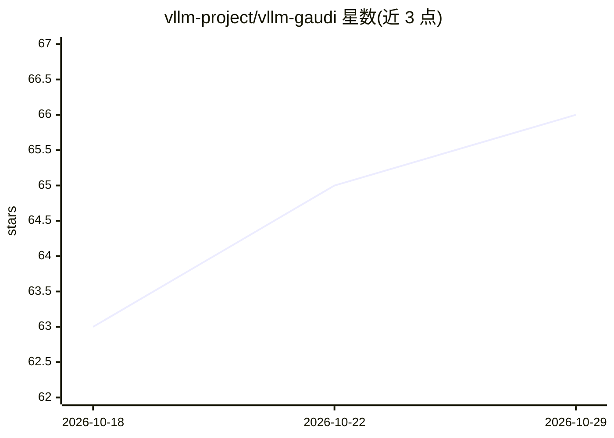

# vllm-project/vllm-gaudi

⭐ 66 · Python · Apache-2.0 · 推送 2026-10-28 · [GitHub](https://github.com/vllm-project/vllm-gaudi) · 组织维护

**让 vLLM 在 Intel Gaudi 加速器上运行推理的硬件插件**

社区维护的 vLLM 硬件插件，按 vLLM 硬件可插拔架构（RFC 11162/19161）将 Intel Gaudi AI 加速器接入 vLLM，用于大模型推理。跟随上游 vLLM 提交进行适配，README 给出从源码克隆、构建 vLLM 并 pip install -e 安装插件的步骤，另需安装 torchaudio（部分模型需要）。多卡服务默认使用 mp 多进程后端，单卡用 uni 进程内后端；HPU 上将 worker 启动方式覆盖为 spawn 以避免驱动状态残留导致的挂起。

## 筛选速览

| 维度 | 判定 | 备注 |
|---|---|---|
| AI 角色 | `ai-ecosystem` | LLM/agent 周边工具 |
| 许可风险 | `permissive` | Apache-2.0 |
| 部署形态 | `library` | 以包/库形式分发 |
| 模型依赖 | local-ok | 支持本地模型 |
| 硬件要求 | — | 无带数字的原话,不猜 |
| 安装摩擦 | `medium` | 含编译或系统依赖之一 |
| 成熟度 | — | 结构信号不足 |

## 能力要点

- 按 vLLM 硬件可插拔架构为 Gaudi 提供模块化接口
- 跟随上游 vLLM 提交适配 API 变化（MoE/MLA、量化、serving 等）
- 多卡默认 mp 多进程后端，HPU 上自动覆盖 worker 启动方式为 spawn
- 新增 MiniMax-M3、Gemma-4、Qwen3-Coder-Next 等模型支持

## 适用场景

- 在 Intel Gaudi HPU 集群上运行 vLLM 大模型推理服务
- 需要 TP/PP/DP 多卡分布式推理的 Gaudi 用户
- 跟踪 Gaudi 平台对 vLLM 上游新特性的适配进展

## 场景标签

`推理引擎` · 领域:训练与推理

## 证据(README 行号)

> L30: The vLLM Hardware Plugin for Intel® Gaudi® integrates Intel® Gaudi® AI accelerators with vLLM to optimize large lan
> L5: vLLM Hardware Plugin for Intel® Gaudi®

## 星数曲线

2026-10-18 63 → 2026-10-29 66（+3）

---
*卡片 v1 · prompt 1.4 · 生成 2026-10-24 · 置信度 mid · 依据 README sha `564eeb908599` · [字段定义](../../DATASET.md)*
