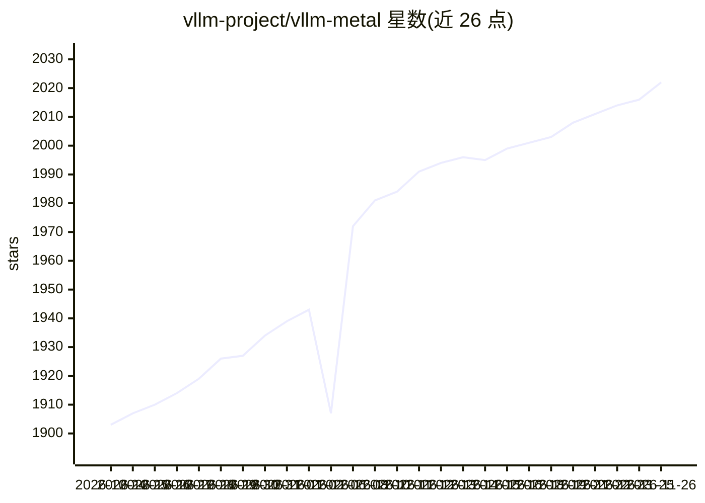

# vllm-project/vllm-metal

⭐ 2,022 · Python · Apache-2.0 · 推送 2026-11-25 · [GitHub](https://github.com/vllm-project/vllm-metal) · [官网](https://docs.vllm.ai/projects/vllm-metal) · 组织维护

**让 vLLM 运行在 Apple Silicon GPU 的社区硬件插件**

以 MLX 为主要计算后端的 vLLM 硬件插件，使 vLLM 可在 Apple Silicon Mac 上运行，统一 MLX 与 PyTorch 为单一 lowering 路径。上游 vLLM 提供 API 服务器、调度器与分页块管理器，mlx_lm 提供逐 token 模型层，vllm-metal 负责请求感知的注意力路径（分页 varlen 内核、M5 NAX prefill、投机解码）。要求 macOS 15 及以上；稳定版经 Homebrew 安装，开发版用 curl 脚本安装，贡献代码需源码构建。

## 筛选速览

| 维度 | 判定 | 备注 |
|---|---|---|
| AI 角色 | `ai-ecosystem` | LLM/agent 周边工具 |
| 许可风险 | `permissive` | Apache-2.0 |
| 部署形态 | `None` |  |
| 模型依赖 | local-ok | 支持本地模型 |
| 硬件要求 | — | 无带数字的原话,不猜 |
| 安装摩擦 | `low` | 无编译、无系统依赖或容器化 |
| 成熟度 | — | 结构信号不足 |

## 能力要点

- MLX 作为主要计算后端，统一 MLX 与 PyTorch 的 lowering 路径
- 分页 varlen Metal 内核为默认注意力后端，支持 M5 NAX prefill 与投机解码
- 通过 vLLM-Omni 支持文本生成图像（SDXL）
- 休眠模式可在空闲时释放内存给其他应用

## 适用场景

- 在 Apple Silicon Mac 上本地运行和提供 LLM 服务
- 在单台 Mac 上服务 27B 级混合架构模型
- 在 Mac 桌面环境下部署文本生成图像服务

## 场景标签

`推理引擎` · 领域:训练与推理

## 证据(README 行号)

> L5: vLLM Metal is a plugin that enables vLLM to run on Apple Silicon Macs using MLX as the primary compute backend. It u
> L24: Upstream vLLM supplies the API server, scheduler, and paged block manager; mlx_lm supplies the token-wise model lay
> L38: - **Stable release:** Install with Homebrew, then run `vllm` without activating an environment.

## 星数曲线

2026-10-24 1,903 → 2026-11-26 2,022（+119）

---
*卡片 v1 · prompt 1.4 · 生成 2026-11-23 · 置信度 high · 依据 README sha `63619a2574ef` · [字段定义](../../DATASET.md)*
