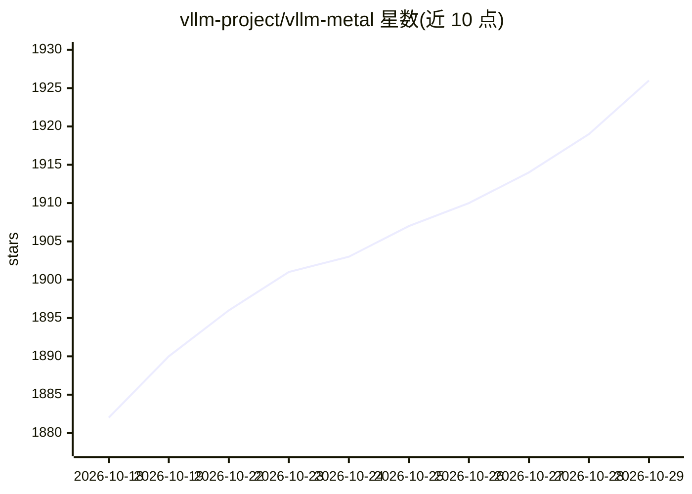

# vllm-project/vllm-metal

⭐ 1,926 · Python · Apache-2.0 · 推送 2026-10-28 · [GitHub](https://github.com/vllm-project/vllm-metal) · [官网](https://docs.vllm.ai/projects/vllm-metal) · 组织维护

**让 vLLM 在 Apple Silicon 上用 MLX 后端运行的硬件插件**

社区维护的 vLLM 硬件插件，使 vLLM 能够在 Apple Silicon Mac 上以 MLX 作为主要计算后端运行，将 MLX 与 PyTorch 统一到单一 lowering 路径。上游 vLLM 提供 API 服务器、调度器与分页块管理，mlx_lm 提供 token 级模型层，vllm-metal 负责请求感知的注意力路径：分页 varlen kernel、M5 NAX prefill 与投机解码。要求 macOS 15 及以上与 Apple Silicon。安装途径包括 Homebrew、curl 安装脚本与源码构建。

## 筛选速览

| 维度 | 判定 | 备注 |
|---|---|---|
| AI 角色 | `ai-ecosystem` | LLM/agent 周边工具 |
| 许可风险 | `permissive` | Apache-2.0 |
| 部署形态 | `None` |  |
| 模型依赖 | local-ok | 支持本地模型 |
| 硬件要求 | — | 无带数字的原话,不猜 |
| 安装摩擦 | `low` | 无编译、无系统依赖或容器化 |
| 成熟度 | — | 结构信号不足 |

## 能力要点

- 以 MLX 为主要计算后端，统一 MLX 与 PyTorch 的 lowering 路径
- 分页 varlen Metal kernel 作为默认注意力后端，支持投机解码
- 使用 M5 NAX 张量单元加速 MHA/GQA/MQA prefill
- 要求 macOS 15+ 与 Apple Silicon

## 适用场景

- 在 Apple Silicon Mac 上本地运行 vLLM 服务
- 在单台 Mac 上服务 Qwen3.8 等 27B 级模型
- 复用 vLLM API 生态同时利用 Metal/MLX 算力

## 场景标签

`推理引擎` · 领域:训练与推理

## 证据(README 行号)

> L5: vLLM Metal is a plugin that enables vLLM to run on Apple Silicon Macs using MLX as the primary compute backend. It u
> L15: Upstream vLLM supplies the API server, scheduler, and paged block manager; mlx_lm supplies the token-wise model lay

## 星数曲线

2026-10-18 1,882 → 2026-10-29 1,926（+44）

---
*卡片 v1 · prompt 1.4 · 生成 2026-10-21 · 置信度 high · 依据 README sha `7b4cd186e498` · [字段定义](../../DATASET.md)*
