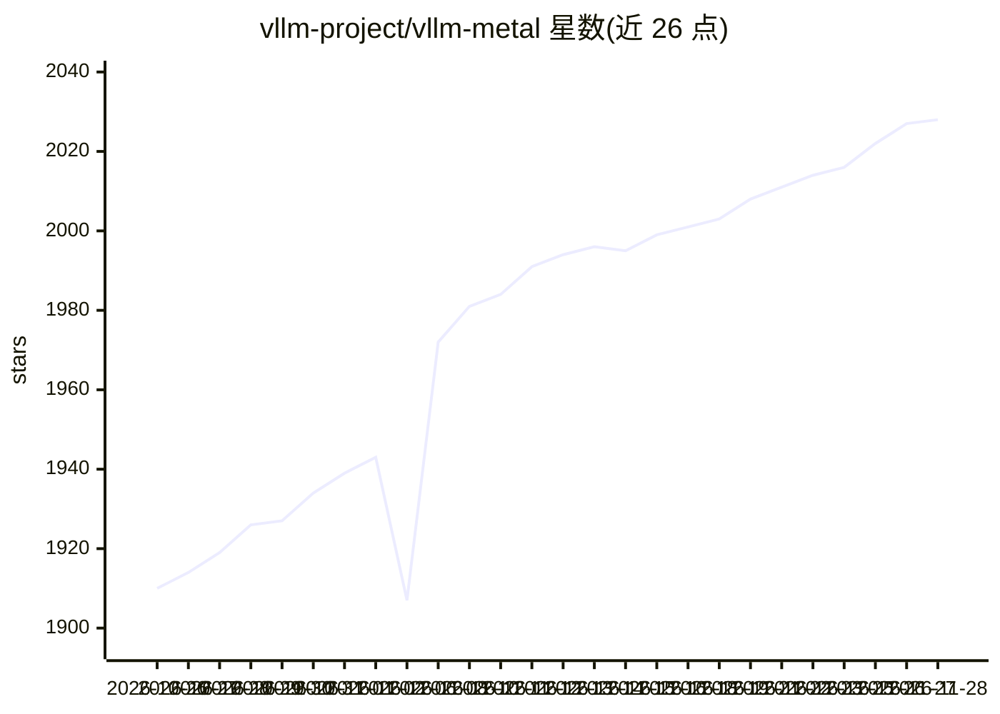

# vllm-project/vllm-metal

⭐ 2,028 · Python · Apache-2.0 · 推送 2026-11-27 · [GitHub](https://github.com/vllm-project/vllm-metal) · [官网](https://docs.vllm.ai/projects/vllm-metal) · 组织维护

**让 vLLM 在 Apple Silicon Mac GPU 上运行的社区硬件插件**

vLLM 的硬件插件，通过以 MLX 为主要计算后端，使 vLLM 能在 Apple Silicon Mac 上运行，并将 MLX 与 PyTorch 统一到单一 lowering 路径。上游 vLLM 提供 API server、调度器与分页块管理器，mlx_lm 提供逐 token 模型层，本插件负责请求感知的注意力路径（分页 varlen kernel、M5 NAX prefill、投机解码）。要求 macOS 15 及以上、Apple Silicon；提供 Homebrew 稳定版、curl 脚本开发版及源码编译三种安装方式。

## 筛选速览

| 维度 | 判定 | 备注 |
|---|---|---|
| AI 角色 | `ai-ecosystem` | LLM/agent 周边工具 |
| 许可风险 | `permissive` | Apache-2.0 |
| 部署形态 | `None` |  |
| 模型依赖 | — | README 未给出锁定关系 |
| 硬件要求 | — | 无带数字的原话,不猜 |
| 安装摩擦 | `low` | 无编译、无系统依赖或容器化 |
| 成熟度 | — | 结构信号不足 |

## 能力要点

- 以 MLX 为主要计算后端，统一 MLX 与 PyTorch 的单一 lowering 路径
- 自研请求感知注意力路径：分页 varlen kernel、M5 NAX prefill、投机解码
- 支持文本生成、文生图（SDXL，经 vLLM-Omni）与并发服务
- 休眠模式可在空闲时将内存归还给其他应用

## 适用场景

- 在 Apple Silicon Mac 上本地部署并服务 LLM
- 桌面环境下让空闲模型服务释放内存给其他应用
- 在 Mac 上运行并发推理服务

## 场景标签

`推理引擎` · 领域:训练与推理

## 证据(README 行号)

> L5: vLLM Metal is a plugin that enables vLLM to run on Apple Silicon Macs using MLX as the primary compute backend. It u
> L25: Upstream vLLM supplies the API server, scheduler, and paged block manager; mlx_lm supplies the token-wise model lay

## 星数曲线

2026-10-26 1,910 → 2026-11-28 2,028（+118）

---
*卡片 v1 · prompt 1.4 · 生成 2026-11-26 · 置信度 high · 依据 README sha `adbcc37de6df` · [字段定义](../../DATASET.md)*
