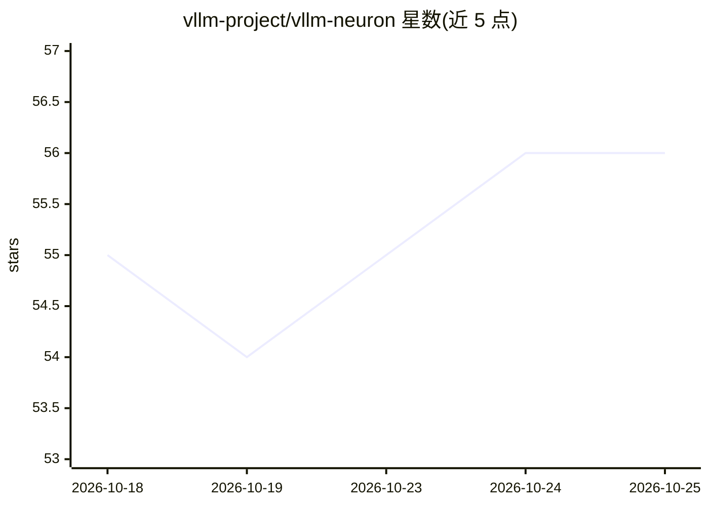

# vllm-project/vllm-neuron

⭐ 56 · Python · Apache-2.0 · 推送 2026-10-20 · [GitHub](https://github.com/vllm-project/vllm-neuron) · 组织维护

**在 AWS Trainium 上运行 vLLM 的社区维护硬件插件**

vLLM 的 Neuron 后端插件，为 AWS Trainium（Trn2/Trn3）实例上的大模型推理提供服务能力：保持 vLLM 原有 API 与配置方式，支持连续批处理、OpenAI 兼容 API、张量/序列/数据/专家等多种并行、Paged KV cache、FP8/MXFP4 量化、EAGLE3 投机解码与分离式推理等；LoRA、流水线并行等暂不支持。模型实现内置于插件，NxD Inference 不再是依赖。从源码 pip 安装，需配合 Neuron SDK；各版本处于 Beta 状态，旧 0.5.x 版本为维护模式。

## 筛选速览

| 维度 | 判定 | 备注 |
|---|---|---|
| AI 角色 | `ai-ecosystem` | LLM/agent 周边工具 |
| 许可风险 | `permissive` | Apache-2.0 |
| 部署形态 | `library` | 以包/库形式分发 |
| 模型依赖 | local-ok | 支持本地模型 |
| 硬件要求 | — | 无带数字的原话,不猜 |
| 安装摩擦 | `low` | 无编译、无系统依赖或容器化 |
| 成熟度 | `idea` | |

## 能力要点

- 为 vLLM 提供 Neuron 后端，保持 vLLM API 与配置
- 支持 TP/SP/DP/EP/CP 并行、分离式推理与 EAGLE3 投机解码
- BF16/FP8/MXFP4 量化与 FP8 量化 KV cache
- Llama 3、GPT-OSS、Qwen3 系列等模型在 Neuron 硬件上经过正确性验证与性能测试

## 适用场景

- 在 AWS Trainium 实例上部署 vLLM 推理服务
- 用 OpenAI 兼容 API 服务文本、多模态与嵌入模型
- 按版本兼容矩阵选择插件与 Neuron SDK 组合

## 场景标签

`推理引擎` · 领域:训练与推理

## 证据(README 行号)

> L3: The vLLM Neuron plugin is the recommended serving solution for large language models on AWS Trainium. It extends vLL
> L139: |0.29.0.1.2.0 (latest)|0.29.0|2.33|Not required|Trn2, Trn3|Beta|vLLM Neuron docs|

## 星数曲线

2026-10-18 55 → 2026-10-25 56（+1）

---
*卡片 v1 · prompt 1.4 · 生成 2026-10-24 · 置信度 high · 依据 README sha `090b568e9621` · [字段定义](../../DATASET.md)*
