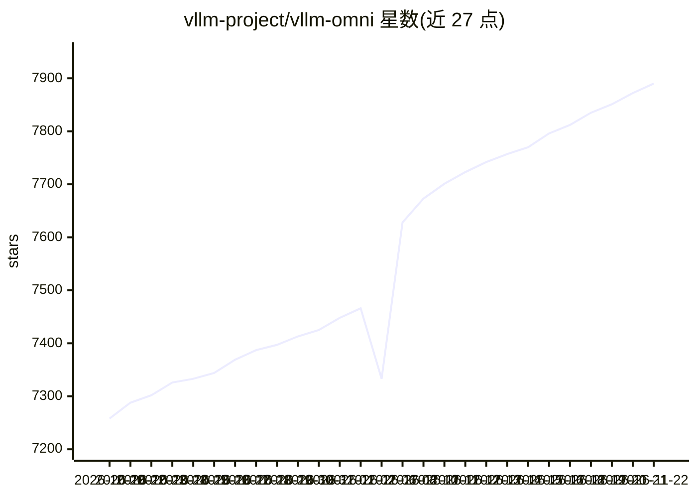

# vllm-project/vllm-omni

⭐ 7,890 · Python · Apache-2.0 · 推送 2026-11-21 · [GitHub](https://github.com/vllm-project/vllm-omni) · [官网](https://docs.vllm.ai/projects/vllm-omni) · 组织维护

**面向开发者的全模态模型推理与服务框架**

vLLM 官方社区发布的扩展框架，将 vLLM 从文本自回归生成扩展到全模态模型的推理与服务：支持文本、图像、音频、视频和动作数据处理，把 vLLM 的自回归支持延伸到 Diffusion Transformer 等非自回归架构。提供流水线阶段重叠执行、基于 OmniConnector 的全分离部署与跨阶段资源分配、张量/流水线/数据/专家并行、流式输出、全双工实时服务与 OpenAI 兼容 API 服务器。以 Python 框架形式分发，安装与部署细节见其文档，支持 CUDA/ROCm/XPU/NPU 等多种硬件后端。

## 筛选速览

| 维度 | 判定 | 备注 |
|---|---|---|
| AI 角色 | `ai-ecosystem` | LLM/agent 周边工具 |
| 许可风险 | `permissive` | Apache-2.0 |
| 部署形态 | `None` |  |
| 模型依赖 | local-ok | 支持本地模型 |
| 硬件要求 | — | 无带数字的原话,不猜 |
| 安装摩擦 | `medium` | 含编译或系统依赖之一 |
| 成熟度 | — | 结构信号不足 |

## 能力要点

- 扩展 vLLM 支持全模态模型（文本/图像/音频/视频/动作）的推理与部署
- 支持 DiT 等非自回归架构与异构流水线抽象
- 提供 OpenAI 兼容 API 服务器与全双工实时音频流服务
- 支持张量、流水线、数据与专家并行及可选 Ray 多节点推理

## 适用场景

- 部署 Qwen3-Omni、MiniCPM-o 等全模态模型的在线服务
- 提供 TTS、语音、图像/视频生成类模型的推理 API
- 部署机器人策略与动作生成模型的服务端
- 需要流式与全双工实时交互的多模态应用后端

## 场景标签

`推理引擎` `多模态` `图像生成` `视频生成` · 领域:内容生成

## 证据(README 行号)

> L22: vLLM was originally designed to support large language models for text-based autoregressive generation tasks. vLLM-
> L24: - **Omni-modality**: Text, image, audio, video, and action data processing
> L42: - OpenAI-compatible API server

## 星数曲线

2026-10-20 7,258 → 2026-11-22 7,890（+632）

---
*卡片 v1 · prompt 1.4 · 生成 2026-11-22 · 置信度 high · 依据 README sha `b7987a3a3e1b` · [字段定义](../../DATASET.md)*
