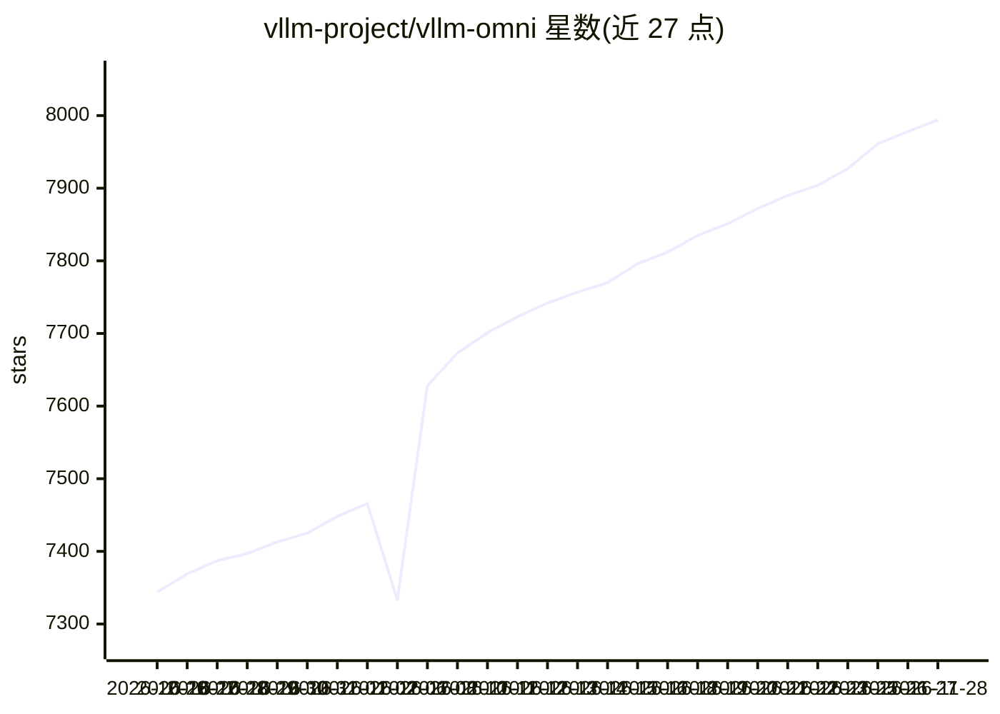

# vllm-project/vllm-omni

⭐ 7,994 · Python · Apache-2.0 · 推送 2026-11-27 · [GitHub](https://github.com/vllm-project/vllm-omni) · [官网](https://docs.vllm.ai/projects/vllm-omni) · 组织维护

**面向开发者的全模态模型推理与 serving 框架**

vLLM 社区发布的框架，将 vLLM 从文本自回归生成扩展到全模态模型推理与服务，支持文本、图像、音频、视频与动作数据的处理，覆盖扩散 Transformer 等非自回归架构与多模态/动作输出。机制上复用 vLLM 的 KV cache 管理、流水线阶段执行重叠、基于 OmniConnector 的全分解与跨阶段资源分配，支持张量/流水线/数据/专家并行、流式输出、OpenAI 兼容 API 与全双工实时 serving。安装与模型列表见官方文档。

## 筛选速览

| 维度 | 判定 | 备注 |
|---|---|---|
| AI 角色 | `ai-ecosystem` | LLM/agent 周边工具 |
| 许可风险 | `permissive` | Apache-2.0 |
| 部署形态 | `None` |  |
| 模型依赖 | local-ok | 支持本地模型 |
| 硬件要求 | — | 无带数字的原话,不猜 |
| 安装摩擦 | `medium` | 含编译或系统依赖之一 |
| 成熟度 | — | 结构信号不足 |

## 能力要点

- 扩展 vLLM 支持 Diffusion Transformer 等非自回归架构
- 复用 vLLM KV cache 管理并提供流水线阶段执行重叠
- 支持张量/流水线/数据/专家并行与分布式推理
- 提供 OpenAI 兼容 API server 与全双工实时音频 serving

## 适用场景

- 部署 Qwen3-Omni、MiniCPM-o 等全模态模型的服务
- 进行图像/视频/音频扩散模型的推理服务
- 为机器人策略与动作模型提供 serving
- 实时全双工语音对话场景的模型服务

## 场景标签

`推理引擎` `多模态` · 领域:感知与多模态

## 证据(README 行号)

> L22: vLLM was originally designed to support large language models for text-based autoregressive generation tasks. vLLM-
> L24: - **Omni-modality**: Text, image, audio, video, and action data processing
> L42: - OpenAI-compatible API server

## 星数曲线

2026-10-26 7,344 → 2026-11-28 7,994（+650）

---
*卡片 v1 · prompt 1.4 · 生成 2026-11-28 · 置信度 high · 依据 README sha `35aaed6d7f49` · [字段定义](../../DATASET.md)*
