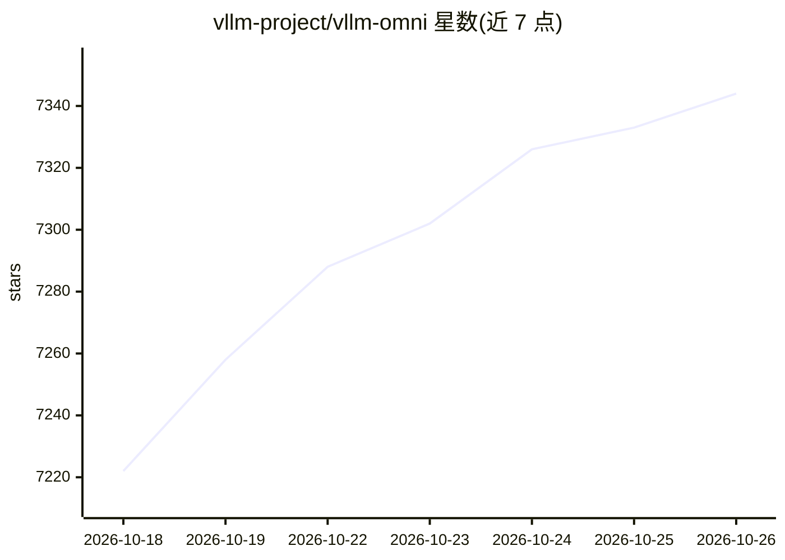

# vllm-project/vllm-omni

⭐ 7,344 · Python · Apache-2.0 · 推送 2026-10-25 · [GitHub](https://github.com/vllm-project/vllm-omni) · [官网](https://docs.vllm.ai/projects/vllm-omni) · 组织维护 · 中文 README

**面向全模态模型（文本/图像/音频/视频/动作）的高效推理与服务框架**

vLLM-Omni 由 vLLM 社区发布，把 vLLM 的推理能力从文本自回归扩展到全模态：支持 DiT 等非自回归架构、异构多模态输出、全双工实时语音服务与机器人策略模型服务。机制上复用 vLLM 的 KV cache 管理，提供流水线阶段重叠、基于 OmniConnector 的全分离部署、张量/流水线/数据/专家并行、流式输出与 OpenAI 兼容 API server。集成 HuggingFace 上的 Qwen3-Omni、MiniCPM-o、MiniMax H3、π0 等模型；硬件覆盖 CUDA/ROCm/XPU/NPU/MUSA。需从源码或 Docker 镜像部署，安装细节在文档站。

## 筛选速览

| 维度 | 判定 | 备注 |
|---|---|---|
| AI 角色 | `ai-ecosystem` | LLM/agent 周边工具 |
| 许可风险 | `permissive` | Apache-2.0 |
| 部署形态 | `None` |  |
| 模型依赖 | local-ok | 支持本地模型 |
| 硬件要求 | — | 无带数字的原话,不猜 |
| 安装摩擦 | `medium` | 含编译或系统依赖之一 |
| 成熟度 | — | 结构信号不足 |

## 能力要点

- 全模态覆盖：文本、图像、音频、视频与动作数据处理与生成
- 非自回归架构支持：扩展 vLLM 至 Diffusion Transformer 等并行生成模型
- 全双工实时服务：流式音频输入输出
- OpenAI 兼容 API server 与张量/流水线/数据/专家并行分布式推理

## 适用场景

- 部署 Qwen3-Omni、MiniCPM-o 等全模态对话与实时语音模型
- 提供图像/视频/音频扩散模型的批量生成服务
- 为机器人策略模型（π0、GR00T 等）搭建推理服务

## 场景标签

`推理引擎` `多模态` · 领域:感知与多模态

## 证据(README 行号)

> L21: vLLM was originally designed to support large language models for text-based autoregressive generation tasks. vLLM-
> L41: - OpenAI-compatible API server

## 星数曲线

2026-10-18 7,222 → 2026-10-26 7,344（+122）

---
*卡片 v1 · prompt 1.4 · 生成 2026-10-20 · 置信度 high · 依据 README sha `8c5e597284f3` · [字段定义](../../DATASET.md)*
