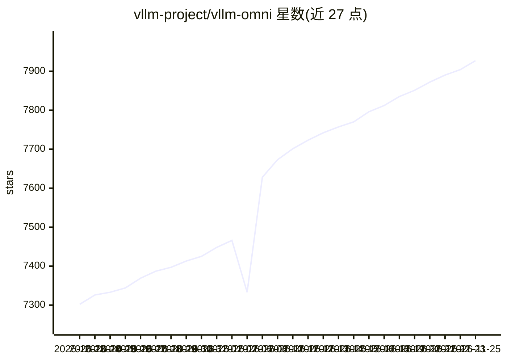

# vllm-project/vllm-omni

⭐ 7,927 · Python · Apache-2.0 · 推送 2026-11-24 · [GitHub](https://github.com/vllm-project/vllm-omni) · [官网](https://docs.vllm.ai/projects/vllm-omni) · 组织维护

**面向全模态模型推理与服务框架 vLLM 的扩展运行时**

vLLM 社区官方发布的扩展框架，将 vLLM 从文本自回归生成扩展到全模态模型的推理与服务：处理文本、图像、音频、视频与动作数据，把 vLLM 的自回归支持延伸到扩散 Transformer 等非自回归架构。提供分阶段流水线执行、跨阶段 KV 与多模态负载传输、张量/流水线/数据/专家并行、流式输出、OpenAI 兼容 API 服务器与全双工实时服务，覆盖 TTS、图像/视频生成、机器人策略等模型。Apache-2.0 许可。

## 筛选速览

| 维度 | 判定 | 备注 |
|---|---|---|
| AI 角色 | `ai-ecosystem` | LLM/agent 周边工具 |
| 许可风险 | `permissive` | Apache-2.0 |
| 部署形态 | `None` |  |
| 模型依赖 | local-ok | 支持本地模型 |
| 硬件要求 | — | 无带数字的原话,不猜 |
| 安装摩擦 | `medium` | 含编译或系统依赖之一 |
| 成熟度 | — | 结构信号不足 |

## 能力要点

- 统一服务文本、音频、图像、视频与动作生成
- 基于 OmniConnector 的跨阶段全分离与动态资源分配
- 支持张量、流水线、数据与专家并行
- OpenAI 兼容 API 服务器与全双工实时音频流服务

## 适用场景

- 部署 Qwen3-Omni、MiniCPM-o 等全模态模型的推理服务
- 搭建 TTS 与语音的实时全双工服务
- 以服务化方式运行扩散模型做图像/视频生成
- 在机器人系统中服务策略与动作模型

## 场景标签

`推理引擎` `多模态` `语音合成` `图像生成` · 领域:内容生成

## 证据(README 行号)

> L18: - [2025/11] vLLM community officially released vllm-project/vllm-omni in order to support omni-modality models serv
> L22: vLLM was originally designed to support large language models for text-based autoregressive generation tasks. vLLM-
> L42: - OpenAI-compatible API server

## 星数曲线

2026-10-23 7,302 → 2026-11-25 7,927（+625）

---
*卡片 v1 · prompt 1.4 · 生成 2026-11-24 · 置信度 high · 依据 README sha `f11a0a4239fa` · [字段定义](../../DATASET.md)*
