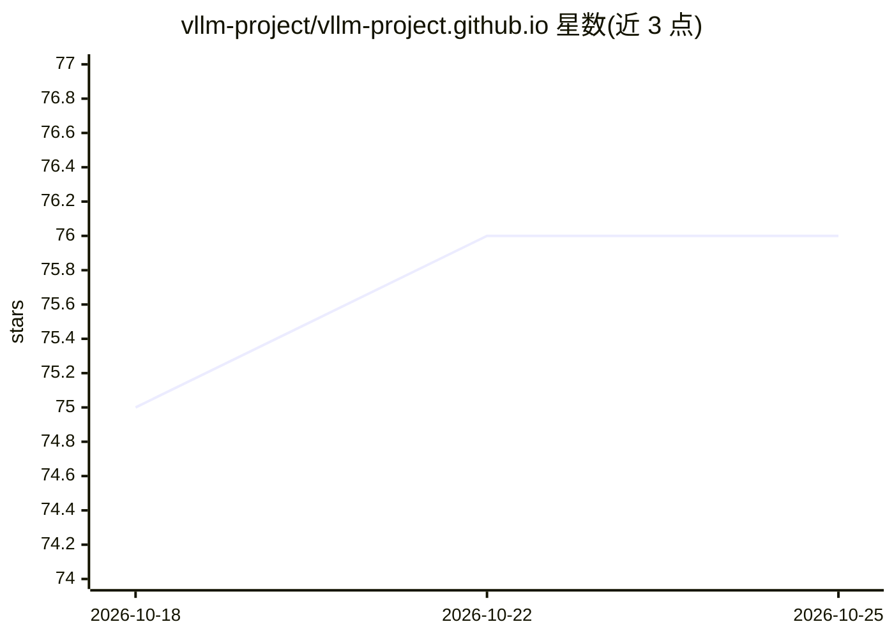

# vllm-project/vllm-project.github.io

⭐ 76 · HTML · 推送 2026-10-23 · [GitHub](https://github.com/vllm-project/vllm-project.github.io) · [官网](https://vllm.ai/blog) · 组织维护

**vLLM 官方博客站点的 Jekyll 源码与博文写作指南**

vLLM 项目的 GitHub Pages 博客源码仓库，基于 Jekyll 与 Minima 主题构建，由 GitHub Actions 在 main 分支推送时自动构建部署。README 说明本地开发步骤（安装 jekyll/bundler、bundle exec jekyll server 启动）、新增博文的流程（参考 _posts 示例、配置 summary 与图片目录、提 PR）、MathJax 数学公式与 GitHub 风格 admonition 语法支持及主题定制方法。面向为 vLLM 撰写博文的贡献者，非 vLLM 推理引擎本体。

## 筛选速览

| 维度 | 判定 | 备注 |
|---|---|---|
| AI 角色 | `ai-knowledge` | 知识聚合/清单类 |
| 许可风险 | `none` | — |
| 部署形态 | `None` |  |
| 模型依赖 | — | README 未给出锁定关系 |
| 硬件要求 | — | 无带数字的原话,不猜 |
| 安装摩擦 | `low` | 无编译、无系统依赖或容器化 |
| 成熟度 | — | 结构信号不足 |

## 能力要点

- Jekyll + Minima 主题博客，GitHub Actions 自动构建部署
- 博文支持 MathJax LaTeX 数学公式与 GFM admonition 语法
- 提供新增博文与 PR 的流程说明

## 适用场景

- 本地预览和调试 vLLM 官方博客
- 为 vLLM 博客撰写并提交新博文
- 定制博客主题或排版功能

## 场景标签

 · 领域:LLM 基础设施/项目文档

## 证据(README 行号)

> L1: # vLLM blog source
> L10: To add a new blogpost, please refer to `_posts/2023-06-20-vllm.md` as an example. Some notes:

## 星数曲线

2026-10-18 75 → 2026-10-25 76（+1）

---
*卡片 v1 · prompt 1.4 · 生成 2026-10-24 · 置信度 mid · 依据 README sha `7b416e800a60` · [字段定义](../../DATASET.md)*
