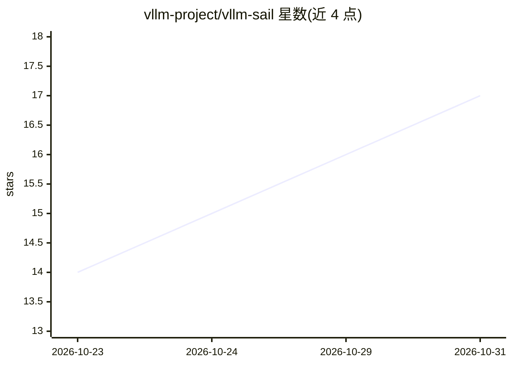

# vllm-project/vllm-sail

⭐ 17 · Python · Apache-2.0 · 推送 2026-10-30 · [GitHub](https://github.com/vllm-project/vllm-sail) · 组织维护 · 中文 README

**让 vLLM 在 T-Head 真武 AI 芯片上运行推理与服务的硬件插件**

社区维护的 vLLM 硬件插件，将 vLLM 推理引擎接入 T-Head SAIL 软件栈，面向使用真武 810E 与真武 M890 AI 加速器的开发者。提供 PPU 原生算子（HGGC 编译）、FlashAttention/MLA/线性注意力后端、DeepGEMM/Triton 计算后端及 BF16/FP16/INT8/FP8 等量化路径，通过标准 vLLM Python API 与 OpenAI 兼容服务器使用。安装需从源码克隆构建，依赖 SAIL SDK、SAIL PyTorch 与 hgcc 工具链，vLLM 需锁定 v0.32.0 发布基线。功能可用性取决于设备、SDK 与检查点格式。

## 筛选速览

| 维度 | 判定 | 备注 |
|---|---|---|
| AI 角色 | `ai-ecosystem` | LLM/agent 周边工具 |
| 许可风险 | `permissive` | Apache-2.0 |
| 部署形态 | `library` | 以包/库形式分发 |
| 模型依赖 | local-ok | 支持本地模型 |
| 硬件要求 | — | 无带数字的原话,不猜 |
| 安装摩擦 | `medium` | 含编译或系统依赖之一 |
| 成熟度 | — | 结构信号不足 |

## 能力要点

- HGGC 编译的 PPU 原生算子：激活、归一化、量化、采样与 MoE 路由
- PPU FlashAttention、MLA、稀疏注意力及 GDN/KDA 线性注意力路径
- DeepGEMM/ACEXT/Triton 后端，支持 BF16/FP16 与 INT8/FP8/MXFP4/INT4 量化
- 提供无需 PPU 即可运行的测试与内核正确性测试

## 适用场景

- 在真武 810E/M890 AI 芯片上部署 vLLM 推理服务
- 通过 OpenAI 兼容接口在国产加速器上服务本地模型
- 为 MoE 与混合架构模型提供 PPU 适配

## 场景标签

`推理引擎` · 领域:训练与推理

## 证据(README 行号)

> L12: vLLM SAIL is a hardware plugin for vLLM.
> L13: It connects vLLM's inference engine to the SAIL software stack, bringing PPU
> L15: vLLM Python API and OpenAI-compatible server.

## 星数曲线

2026-10-23 14 → 2026-10-31 17（+3）

---
*卡片 v1 · prompt 1.4 · 生成 2026-10-30 · 置信度 mid · 依据 README sha `aad8407ce843` · [字段定义](../../DATASET.md)*
