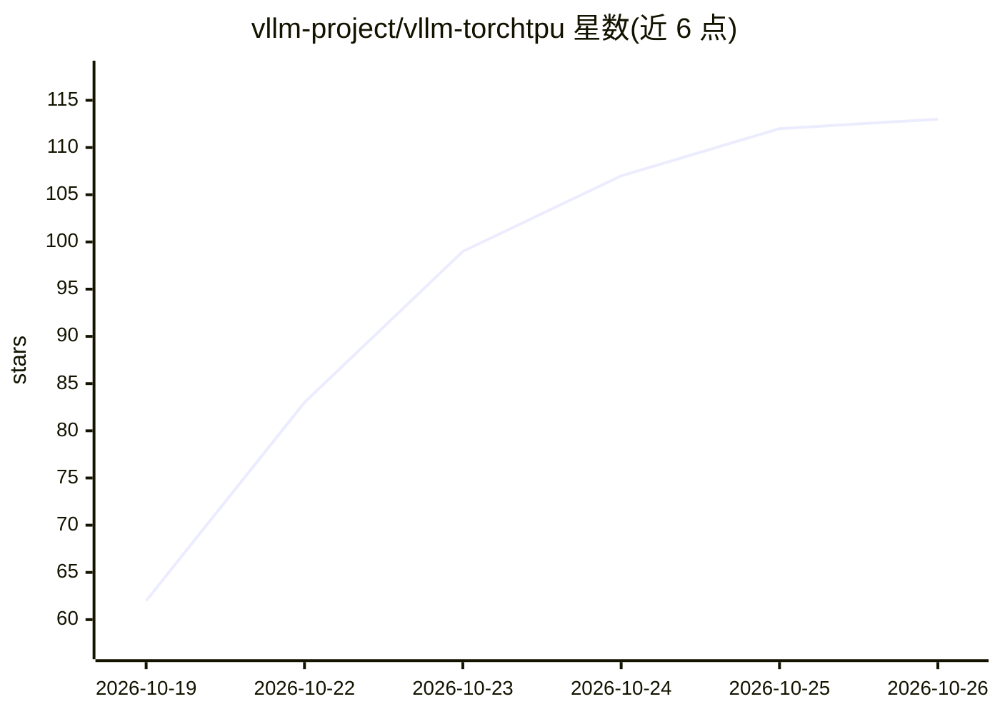

# vllm-project/vllm-torchtpu

⭐ 113 · Python · Apache-2.0 · 推送 2026-10-25 · [GitHub](https://github.com/vllm-project/vllm-torchtpu) · [官网](https://vllm-torchtpu.readthedocs.io/) · 组织维护

**vLLM 的 PyTorch 原生 TPU 后端插件**

vLLM 的 out-of-tree 平台插件，打包为 vllm-torchtpu，通过 TorchTPU（torch.compile backend="tpu"）与 Pallas 自定义 JAX 内核（注意力、MoE、量化 matmul）将 vLLM 标准 PyTorch 模型定义运行在 Google Cloud TPU 上，保持相同 CLI 与 OpenAI 兼容服务，无需修改模型代码。支持 TP/DP/PP/EP 与上下文并行、分离式 prefill/decode 服务，覆盖 Qwen3、DeepSeek、Llama、Gemma 等模型家族。要求 Cloud TPU VM 与 Python 3.12，TPU v7x 经 CI 验证，v6e 支持，v5e/v5p 为实验状态。

## 筛选速览

| 维度 | 判定 | 备注 |
|---|---|---|
| AI 角色 | `ai-ecosystem` | LLM/agent 周边工具 |
| 许可风险 | `permissive` | Apache-2.0 |
| 部署形态 | `self-host` | docker 或自建部署 |
| 模型依赖 | local-ok | 支持本地模型 |
| 硬件要求 | — | 无带数字的原话,不猜 |
| 安装摩擦 | `low` | 无编译、无系统依赖或容器化 |
| 成熟度 | `idea` | |

## 能力要点

- 通过 torch.compile(backend="tpu") 运行 vLLM 原生 PyTorch 模型定义
- Pallas 实现的 Ragged Paged Attention、MLA、fused MoE 与 FP8/INT8/MXFP4 量化 matmul
- TP/DP/PP/EP 及上下文并行，支持分离式 prefill/decode 服务
- 提供 PyPI 安装与 Docker Hub 预构建容器

## 适用场景

- 在 Google Cloud TPU 上以 vLLM 标准 CLI 服务 PyTorch 模型
- TPU 多主机切片上做大规模并行推理部署
- 为 Qwen3/DeepSeek/Llama 等家族模型做 TPU 量化推理

## 场景标签

`推理引擎` · 领域:训练与推理

## 证据(README 行号)

> L9: **vLLM TorchTPU** is the PyTorch-native TPU backend for vLLM. It is an out-of-tree vLLM platform plugin, packaged as
> L11: The goal is simple: **the same vLLM you already use — same CLI, same OpenAI-compatible server, same model definitio

## 星数曲线

2026-10-19 62 → 2026-10-26 113（+51）

---
*卡片 v1 · prompt 1.4 · 生成 2026-10-23 · 置信度 high · 依据 README sha `66e9407e885e` · [字段定义](../../DATASET.md)*
