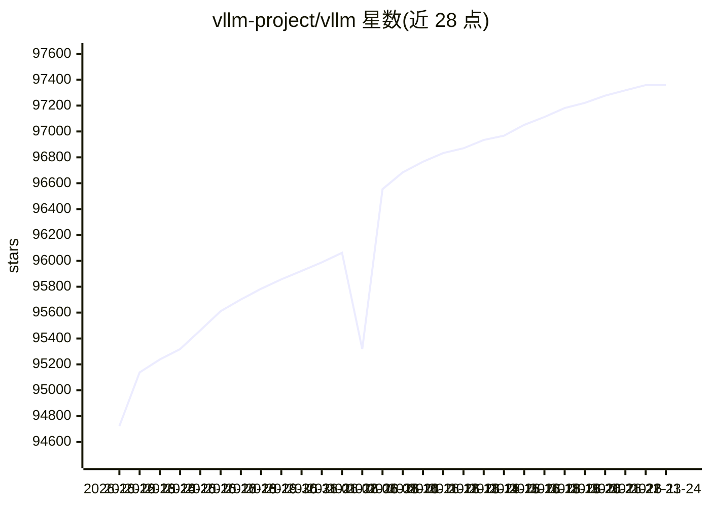

# vllm-project/vllm

⭐ 97,424 · Python · Apache-2.0 · 推送 2026-11-24 · [GitHub](https://github.com/vllm-project/vllm) · [官网](https://vllm.ai)

**面向开发者的 LLM 高吞吐推理与服务平台**

用于 LLM 推理与服务的 Python 库，提供 OpenAI 兼容 API 服务器及 Anthropic Messages API、gRPC 接口。核心机制包括 PagedAttention 的显存管理、连续批处理、前缀缓存、多种量化格式与投机解码，支持张量/流水线/数据/专家/上下文并行做分布式推理。支持 NVIDIA/AMD/Intel GPU、x86/ARM/PowerPC CPU 及 TPU、Gaudi 等硬件插件，可运行 Hugging Face 上 200+ 模型架构。经 uv/pip 安装，亦可从源码构建。

## 筛选速览

| 维度 | 判定 | 备注 |
|---|---|---|
| AI 角色 | `ai-ecosystem` | LLM/agent 周边工具 |
| 许可风险 | `permissive` | Apache-2.0 |
| 部署形态 | `library` | 以包/库形式分发 |
| 模型依赖 | local-ok | 支持本地模型 |
| 硬件要求 | — | 无带数字的原话,不猜 |
| 安装摩擦 | `medium` | 含编译或系统依赖之一 |
| 成熟度 | — | 结构信号不足 |

## 动量与使用信号

- 维护:`active` — 距上次 push 0.6 天,年发版 33,453 位贡献者
- 涨星:近 1 天 **+82**(自 20261016 起算)
- 安装:pypi 包 `vllm` 月下载 1,857,414
- 平台:— · 协议:OPENAI-API

## 能力要点

- PagedAttention 显存管理与连续批处理、前缀缓存
- OpenAI 兼容 API 服务器，另支持 Anthropic Messages API 与 gRPC
- 支持 NVIDIA/AMD/Intel GPU、CPU 及 TPU/Gaudi/Ascend 等硬件插件
- 多 LoRA、结构化输出、工具调用与投机解码支持

## 适用场景

- 为自部署 LLM 提供高吞吐 API 服务
- 在多种 GPU/CPU 硬件上运行 200+ Hugging Face 模型架构
- 做分布式推理与量化部署
- 以兼容 OpenAI API 的方式接入现有应用

## 场景标签

`推理引擎` `模型量化` · 领域:训练与推理

## 证据(README 行号)

> L12: vLLM is a fast and easy-to-use library for LLM inference and serving.
> L37: - OpenAI-compatible API server, plus Anthropic Messages API and gRPC support
> L39: - Support for NVIDIA GPUs, AMD GPUs, Intel GPUs, and x86/ARM/PowerPC CPUs. Additionally, diverse hardware plugins s

## 星数曲线

2026-10-22 94,723 → 2026-11-24 97,358（+2,635）

---
*卡片 v1 · prompt 1.4 · 生成 2026-11-22 · 置信度 high · 依据 README sha `fc38df901c1e` · [字段定义](../../DATASET.md)*
