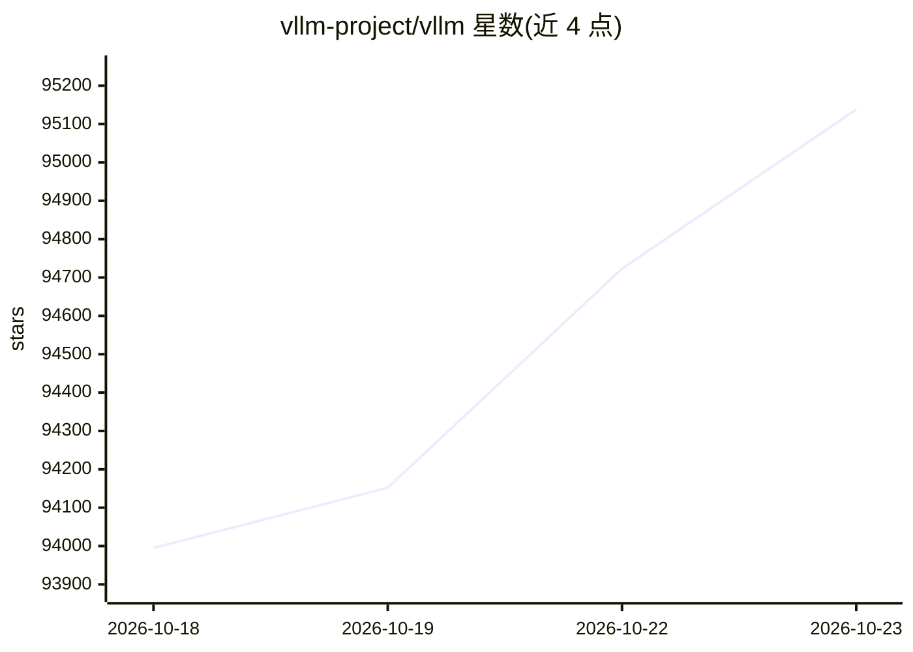

# vllm-project/vllm

⭐ 95,138 · Python · Apache-2.0 · 推送 2026-10-22 · [GitHub](https://github.com/vllm-project/vllm) · [官网](https://vllm.ai) · 组织维护

**面向开发者的 LLM 高吞吐推理与服务引擎**

vLLM 提供 LLM 推理与服务能力：以 PagedAttention 管理 KV 内存，支持连续批处理、chunked prefill、前缀缓存、投机解码与量化方案（FP8/INT8/GPTQ/AWQ/GGUF 等）；兼容 Hugging Face 200+ 模型架构，输出 OpenAI 兼容 API、Anthropic Messages API 与 gRPC，支持张量/流水线/专家并行及多 LoRA。项目源自 UC Berkeley Sky Computing Lab，由社区维护，通过 uv/pip 安装。

## 筛选速览

| 维度 | 判定 | 备注 |
|---|---|---|
| AI 角色 | `ai-native` | 本体是模型或模型工具 |
| 许可风险 | `permissive` | Apache-2.0 |
| 部署形态 | `library` | 以包/库形式分发 |
| 模型依赖 | — | README 未给出锁定关系 |
| 硬件要求 | — | 无带数字的原话,不猜 |
| 安装摩擦 | `medium` | 含编译或系统依赖之一 |
| 成熟度 | — | 结构信号不足 |

## 动量与使用信号

- 维护:`active` — 距上次 push 0.6 天,年发版 33,453 位贡献者
- 涨星:近 1 天 **+82**(自 20261016 起算)
- 安装:pypi 包 `vllm` 月下载 1,857,414
- 平台:— · 协议:OPENAI-API

## 能力要点

- PagedAttention KV 内存管理与连续批处理
- OpenAI 兼容 API 服务器，另支持 Anthropic Messages API 与 gRPC
- 支持 NVIDIA/AMD/Intel GPU 与 x86/ARM/PowerPC CPU 及 TPU、Ascend 等硬件插件
- 200+ Hugging Face 模型架构，覆盖 MoE、多模态、嵌入模型

## 适用场景

- 为自己的模型部署高吞吐推理服务
- 以 OpenAI 兼容 API 对外提供 LLM 服务
- 在多种 GPU/CPU 硬件上运行量化模型推理

## 场景标签

`推理引擎` · 领域:训练与推理

## 证据(README 行号)

> L12: vLLM is a fast and easy-to-use library for LLM inference and serving.
> L37: - OpenAI-compatible API server, plus Anthropic Messages API and gRPC support
> L39: - Support for NVIDIA GPUs, AMD GPUs, Intel GPUs, and x86/ARM/PowerPC CPUs. Additionally, diverse hardware plugins s

## 星数曲线

2026-10-18 93,995 → 2026-10-23 95,138（+1,143）

---
*卡片 v1 · prompt 1.4 · 生成 2026-10-18 · 置信度 high · 依据 README sha `7a5690629d1d` · [字段定义](../../DATASET.md)*
