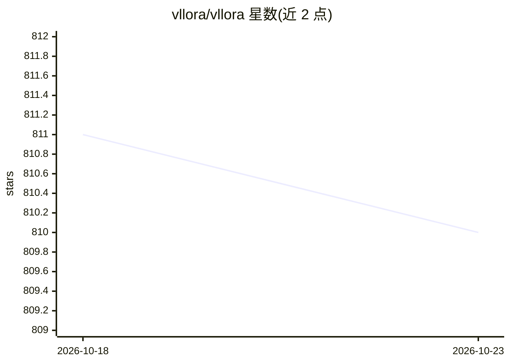

# vllora/vllora

⭐ 810 · Rust · NOASSERTION · 推送 2026-06-30 · [GitHub](https://github.com/vllora/vllora) · [官网](https://vllora.dev) · 组织维护

**AI Agent 实时调试网关：OpenAI 兼容代理收集调用追踪**

以 Rust 编写的本地网关/服务器：Agent 通过其 OpenAI 兼容的 chat completions API 发起调用，vLLora 自动收集每次交互的追踪与调试信息，服务器运行于 localhost:9090，UI 在 9091 端口，可在 UI 中配置各 AI 提供商的 API key。面向使用 LangChain、Google ADK、OpenAI 等框架构建 Agent 的开发者，支持实时追踪调用、工具交互与工作流，并支持经 HTTP/SSE 连接 MCP 服务器。提供 Homebrew 安装与源码编译（cargo build）两种途径，按 Elastic License 2.0 fair-code 分发。

## 筛选速览

| 维度 | 判定 | 备注 |
|---|---|---|
| AI 角色 | `ai-ecosystem` | LLM/agent 周边工具 |
| 许可风险 | `none` | NOASSERTION |
| 部署形态 | `None` |  |
| 模型依赖 | — | README 未给出锁定关系 |
| 硬件要求 | — | 无带数字的原话,不猜 |
| 安装摩擦 | `medium` | 含编译或系统依赖之一 |
| 成熟度 | — | 结构信号不足 |

## 能力要点

- OpenAI 兼容 chat completions 代理，自动收集每次交互的追踪与调试信息
- 实时监控 Agent 调用、工具交互与工作流的可观测性
- 支持经 HTTP/SSE 连接 MCP 服务器
- 提供 Rust 客户端 VlloraLLMClient 流式示例

## 适用场景

- 调试 AI Agent 的调用链与工具交互
- 在本地统一配置多个 AI 提供商 API key 并观测流量
- 为 LangChain / Google ADK 构建的 Agent 接入追踪

## 场景标签

 · 领域:LLM 基础设施/可观测性

## 证据(README 行号)

> L5: Debug your Agents in Real Time. Trace, analyze, and optimize instantly. Seamless with LangChain, Google ADK, OpenAI,
> L26: vLLora uses OpenAI-compatible chat completions API, so when your AI agents make calls through vLLora, it automatica
> L82: **Real-time Tracing** - Monitor AI agent interactions as they happen with live observability of calls, tool interac

## 星数曲线

2026-10-18 811 → 2026-10-23 810（-1）

---
*卡片 v1 · prompt 1.4 · 生成 2026-10-21 · 置信度 high · 依据 README sha `d93ad54cd122` · [字段定义](../../DATASET.md)*
