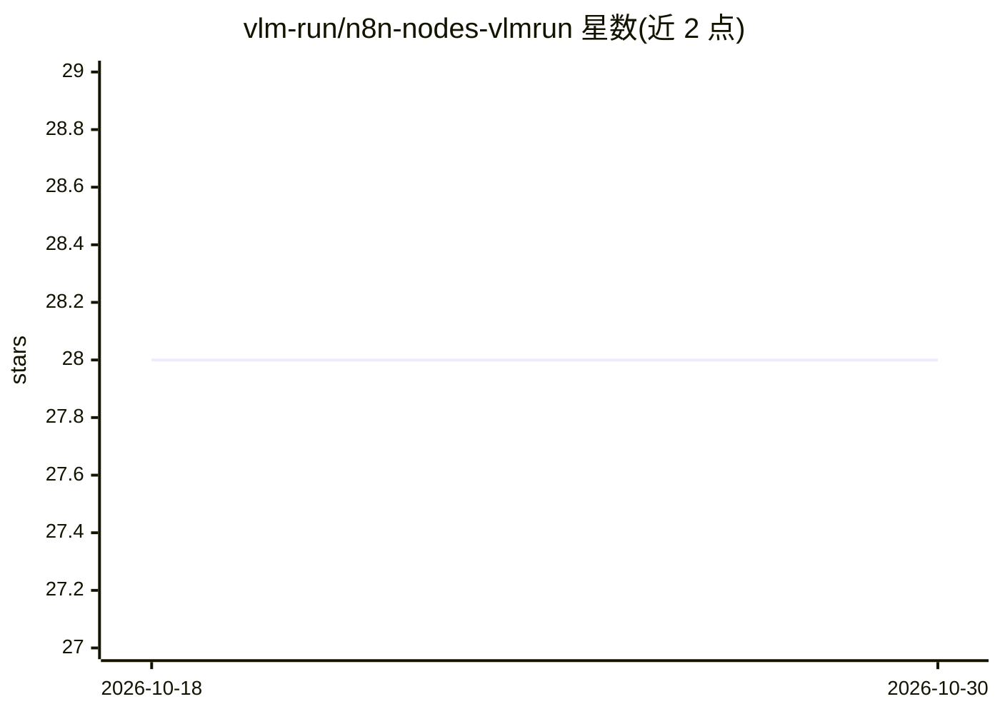

# vlm-run/n8n-nodes-vlmrun

⭐ 28 · TypeScript · MIT · 推送 2026-06-15 · [GitHub](https://github.com/vlm-run/n8n-nodes-vlmrun) · [官网](https://docs.vlm.run/integrations/integrations-n8n) · 组织维护

**让 n8n 工作流调用 VLM Run 视觉 AI 服务的社区节点**

n8n 社区节点包，将 VLM Run（面向视觉 AI 的统一网关服务）接入 n8n 工作流。提供五类操作：分析音频（转录、说话人识别、情感分析）、从文档（简历/发票/演示文稿）抽取结构化数据、图像信息抽取与描述生成、视频洞察提取与转录，以及 VLM Run 账户文件管理。使用需注册 VLM Run 账号并配置 API key（默认 base URL 为 api.vlm.run/v1），通过 npm 安装。面向使用 n8n 构建自动化流程的开发者与自动化使用者。

## 筛选速览

| 维度 | 判定 | 备注 |
|---|---|---|
| AI 角色 | `ai-ecosystem` | LLM/agent 周边工具 |
| 许可风险 | `permissive` | MIT |
| 部署形态 | `library` | 以包/库形式分发 |
| 模型依赖 | — | README 未给出锁定关系 |
| 硬件要求 | — | 无带数字的原话,不猜 |
| 安装摩擦 | `low` | 无编译、无系统依赖或容器化 |
| 成熟度 | — | 结构信号不足 |

## 能力要点

- 五种操作：音频/文档/图像/视频分析与文件管理
- 文档抽取覆盖简历、发票、演示文稿等
- 通过 VLM Run API key 与自定义 base URL 接入

## 适用场景

- 在 n8n 工作流中从简历或发票抽取结构化数据
- 批量给商品图片生成描述或编目
- 在自动化流程中转录并分析音频或视频内容

## 场景标签

`工作流自动化` `文档解析` `图像视频处理` `语音识别` · 领域:效率与自动化

## 证据(README 行号)

> L12: This is an n8n community node. It lets you use VLM Run in your n8n workflows.
> L14: VLM Run is a unified gateway for Visual AI that enables you to extract structured data from unstructured visual con

## 星数曲线

2026-10-18 28 → 2026-10-30 28（+0）

---
*卡片 v1 · prompt 1.4 · 生成 2026-10-26 · 置信度 high · 依据 README sha `d80a72c355e6` · [字段定义](../../DATASET.md)*
